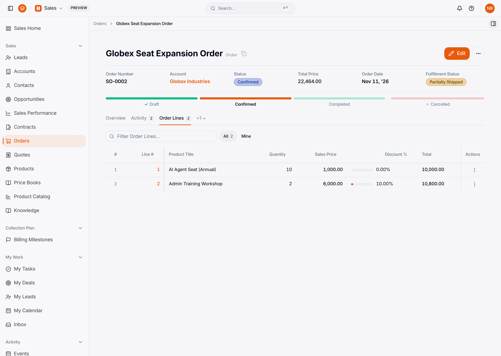
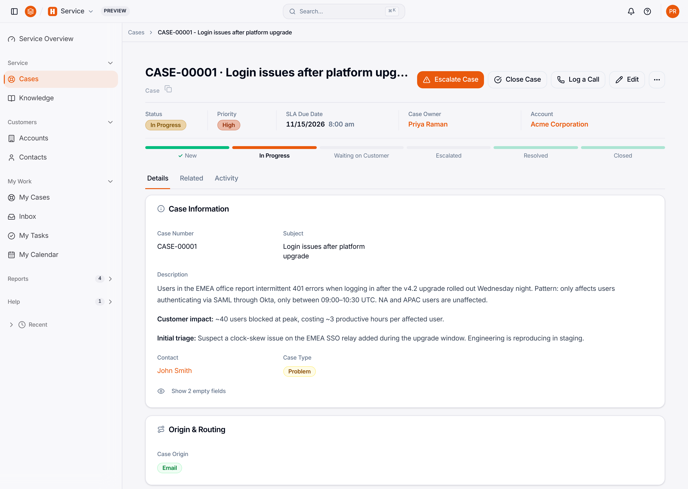
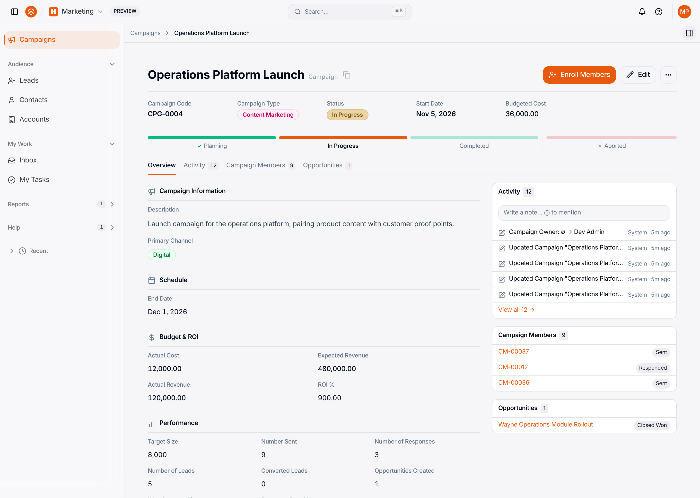
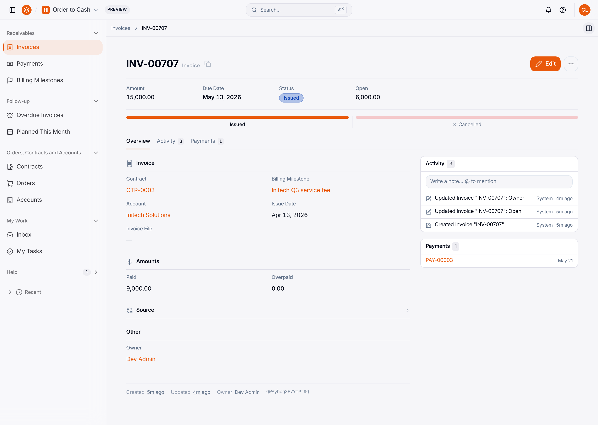
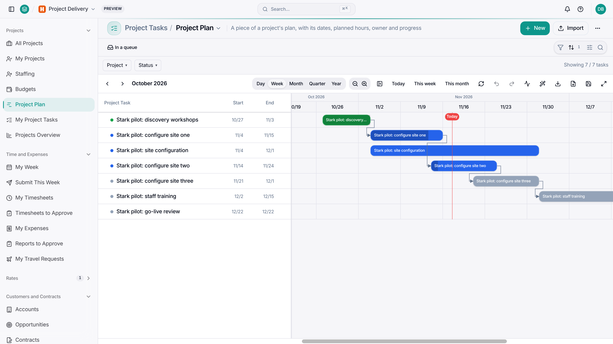
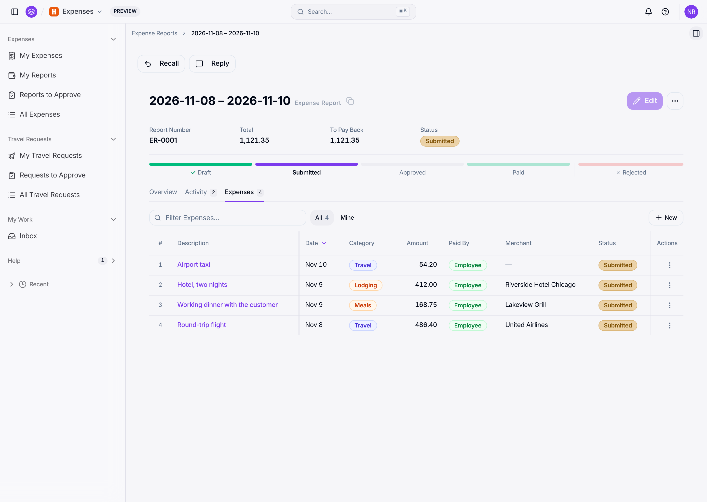

<p align="center">
  
</p>

# HotCRM

<!-- shared:headline -->

**Leads, orders, projects, cash and expenses in one open-source business system.**

Change it with AI when your business changes. Let your own AI agents work in it with each user's permissions.

<!-- /shared:headline -->

[](LICENSE)
[](src/sales/index.ts)
[](CHANGELOG.md)
[](https://cloud.objectos.ai)

[Documentation](https://hotcrm.com/docs) · [Marketplace](https://cloud.objectos.ai) · [中文说明](https://github.com/objectstack-ai/hotcrm/blob/main/README.zh-CN.md)

---

<!-- section:who -->
## Who it is for

Companies that sell products, project services or subscriptions, and want sales, service, delivery and finance on one system. Three sample scenarios walk the whole chain:

- [A product sale](https://hotcrm.com/docs/getting-started/scenario-product-sale): lead, opportunity, quote, order, contract, invoice and payment, and where each step hands over.
- [Project services](https://hotcrm.com/docs/getting-started/scenario-project-services): the deal, the contract and its collection plan, the project with its plan, budget, timesheets and expenses, and the invoices finance records.
- [A subscription](https://hotcrm.com/docs/getting-started/scenario-subscription): the contract with its terms and renewal, one collection step per period, the invoices, and the renewal deal.

<!-- section:chain -->
## One chain, from the first lead to the cash

<!-- shared:chain -->

[Lead](https://hotcrm.com/docs/sales/leads) → [Opportunity](https://hotcrm.com/docs/sales/opportunities) → [Quote](https://hotcrm.com/docs/sales/quotes) → [Order](https://hotcrm.com/docs/sales/orders) → [Contract or project](https://hotcrm.com/docs/sales/contracts) → [Invoice and payment](https://hotcrm.com/docs/order-to-cash/invoices-and-payments)

[Approved hours, travel and expenses on a project count in its cost, so the margin is measured against what the customer pays.](https://hotcrm.com/docs/projects/time-and-expenses)

<!-- /shared:chain -->

It is one data set from the first lead to the last payment: nothing is exported from one system and imported into the next.

<!-- section:apps -->
## Six apps

<!-- shared:apps -->

Everyone opens the app for their job. Sales is always there; an administrator can switch the other five off.

| App | For | What it does |
| --- | --- | --- |
| [Sales](https://hotcrm.com/docs/sales) | Sales reps and managers | Leads, accounts, opportunities, quotes and products, orders and contracts. |
| [Service](https://hotcrm.com/docs/service) | Service agents and managers | Cases with SLAs and escalation, and the knowledge base. |
| [Marketing](https://hotcrm.com/docs/marketing) | Marketers | Campaigns, and the leads and contacts they reach. |
| [Order to Cash](https://hotcrm.com/docs/order-to-cash) | Finance | Each account's collection plan, and its invoices and payments with or without a contract. |
| [Project Delivery](https://hotcrm.com/docs/projects) | Project managers, consultants and finance | Projects, staffing, plans, timesheets and budgets, with cost and margin. |
| [Expenses](https://hotcrm.com/docs/expenses) | Every employee | Expenses with their receipts, expense reports, travel requests and their approval. |

<!-- /shared:apps -->

<!-- section:screenshots -->
## Screenshots

One screen from each app, captured on ObjectStack 18.5.0 from a fresh database with the shipped sample data and the demo team (`pnpm demo:staff`).

| Sales: sales order with its lines | Service: support case |
| --- | --- |
|  |  |

| Marketing: campaign lifecycle and ROI | Order to Cash: invoice with its payment |
| --- | --- |
|  |  |

| Project Delivery: project plan on a Gantt | Expenses: expense report with its expenses |
| --- | --- |
|  |  |

<!-- section:ai -->
## AI and agents

Every HotCRM object is open over MCP, at `/api/v1/mcp` on every environment. Your agent connects as a person, by browser sign-in or with that person's API key, and works under that person's permission sets, positions and sharing rules: where the person would be refused, the agent is refused, with the same code and message.

HotCRM is agent-first. It provides the objects, the actions and the skills; reading a receipt, checking a policy or chasing a payment is the work of your own agent over MCP. The community edition runs no assistant of its own, so you connect yours. HotCRM ships **8 skills** for the platform assistant, where an environment runs one, and opens **9 of its actions to agents**, among them Convert Lead and Submit for Reimbursement; an action that cannot be undone, or that sends a record to an approver, asks the person first.

[Connect your agent](https://hotcrm.com/docs/ai-copilot/connect-your-agent) shows the endpoint, the sign-in, the tools an agent gets, and the same call made by two people with different permissions.

<!-- section:install -->
## Try and install

**From the marketplace.** Sign in at [cloud.objectos.ai](https://cloud.objectos.ai), open HotCRM in the marketplace and install it into your environment. New to ObjectStack? Create an environment from the Starter template first.

**On your machine, in three commands** (Node.js 22 or later, and pnpm 10):

```bash
git clone https://github.com/objectstack-ai/hotcrm.git && cd hotcrm
pnpm install
pnpm dev
```

Open <http://localhost:4001/_console/> and sign in as `admin@objectos.ai` / `admin123`, the administrator a development server creates on an empty database. The sample data loads on the first start; `pnpm demo:staff`, in a second terminal, adds the demo team.

<!-- section:customize -->
## Customize with AI

The definition is the app. Objects and fields, rules, screens, flows, permissions and translations are typed metadata under `src/`: change a field there and the table, the API and the screens follow, with no second application to keep in step. An AI coding agent such as Claude Code writes that change in your copy of the repository, and `pnpm validate` checks it against the platform's schema before it ships.

Today the definition holds **38 business objects**, **56 actions**, **55 flows**, **7 dashboards**, **11 datasets** and **18 positions**, in **4 languages** (en, zh-CN, es-ES, ja-JP).

HotCRM is built on [ObjectStack](https://github.com/objectstack-ai/objectstack), the open-source platform that runs one business definition as the database, the API, the screens and the agent tools at once. [Customize and extend](https://hotcrm.com/docs/developers/customize-and-extend) walks through a change.

<!-- section:developers -->
## Developers

HotCRM is one artifact of seven packages: the Sales app and six modules an administrator can switch off ([Enable and disable modules](https://hotcrm.com/docs/administration/modules)).

```
hotcrm/
├── objectstack.config.ts         # composeStacks(): the one artifact, carrying the seven package stacks
├── objectstack.composition.ts    # the package stacks, built
├── src/
│   ├── sales/                    # the app package: accounts, contacts, leads, opportunities, orders, contracts, activities
│   ├── service/                  # module: cases, SLAs, the knowledge base
│   ├── revenue/                  # module: products, price books, quotes (shown inside Sales)
│   ├── marketing/                # module: campaigns and their members
│   ├── o2c/                      # module: collection plans, invoices, payments (Order to Cash)
│   ├── psa/                      # module: projects, staffing, plans, timesheets, budgets (Project Delivery)
│   ├── expense/                  # module: expenses, expense reports, travel requests
│   └── docs/                     # the in-app manuals, shipped inside the artifact
├── apps/docs/                    # the docs site, published at https://hotcrm.com/docs
└── content/docs/                 # the docs content, in en, zh-Hans and zh-Hant
```

```bash
pnpm dev            # the app at http://localhost:4001
pnpm verify         # validate, typecheck, lint, hygiene, build and test: run it before a pull request
pnpm build          # dist/objectstack.json, the artifact the marketplace installs
pnpm docs:product   # rewrite the shared product blocks after changing an app or apps/docs/lib/product/product.json
```

Read [CONTRIBUTING](https://github.com/objectstack-ai/hotcrm/blob/main/CONTRIBUTING.md) before a first pull request, and the [Developers](https://hotcrm.com/docs/developers) section of the docs for the architecture, the API, testing and [publishing your own copy to the marketplace](https://hotcrm.com/docs/developers/publishing-your-first-app).

<!-- section:license -->
## License

Apache-2.0, like ObjectStack. See [LICENSE](https://github.com/objectstack-ai/hotcrm/blob/main/LICENSE).
