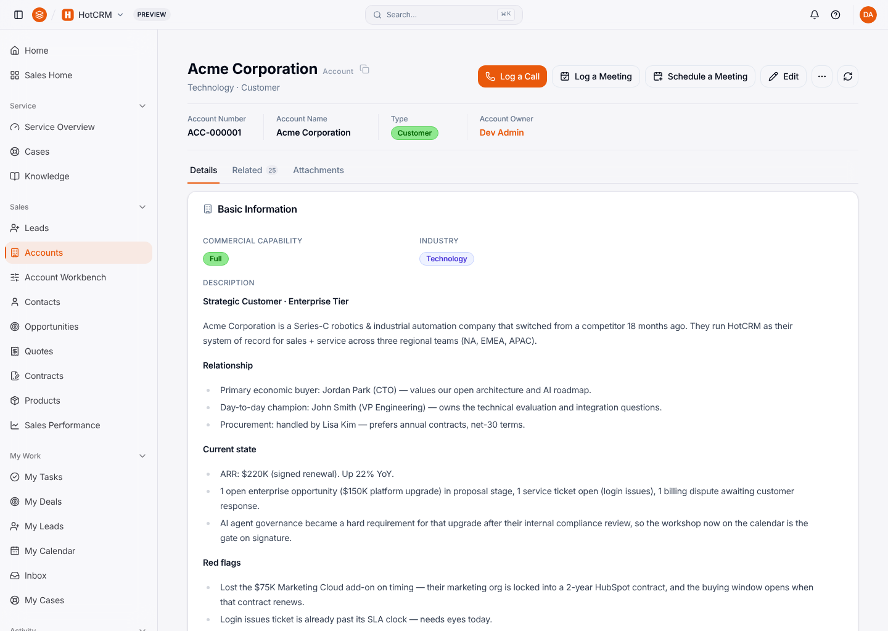
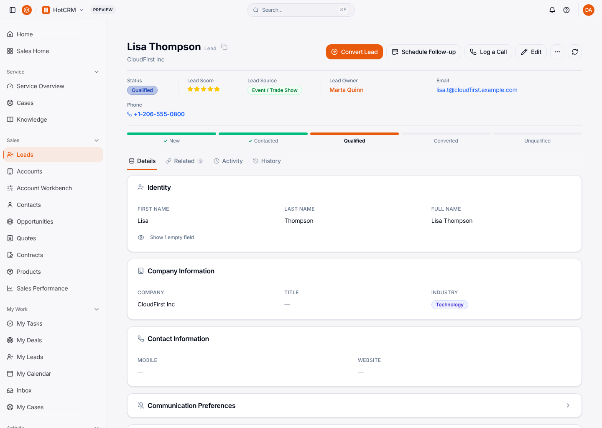
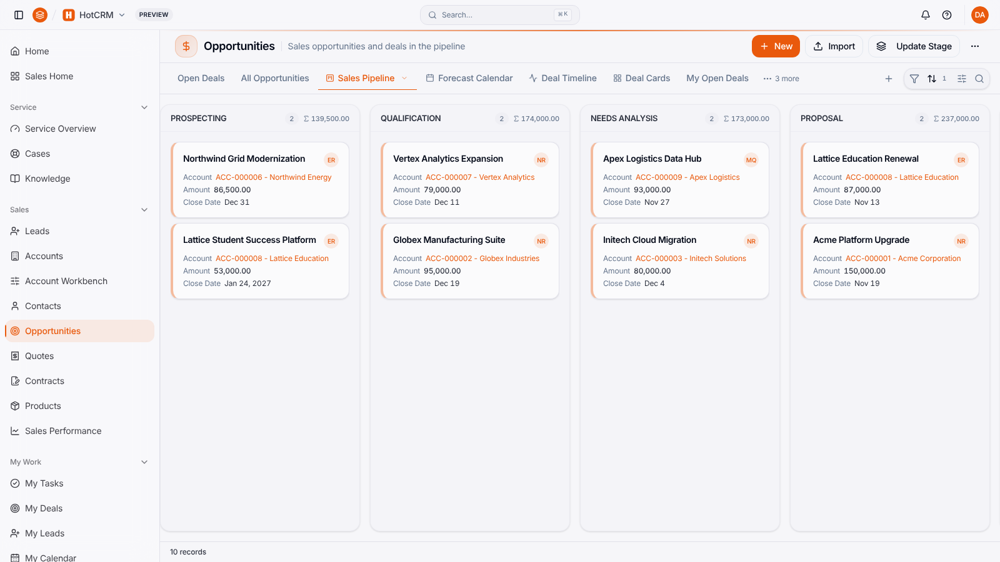
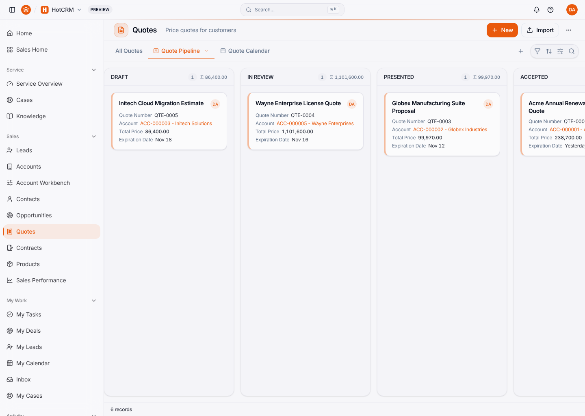
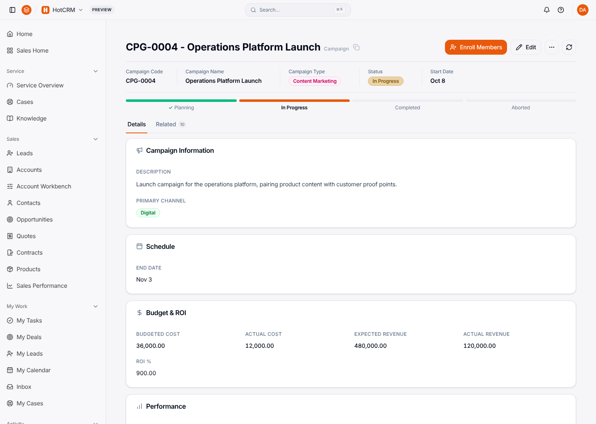
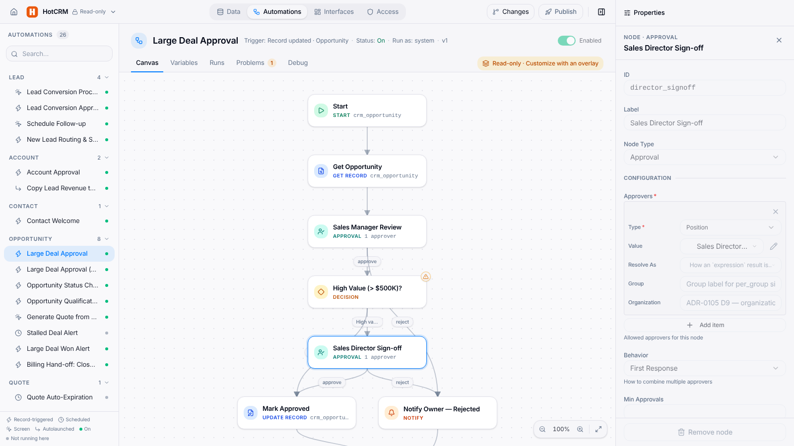
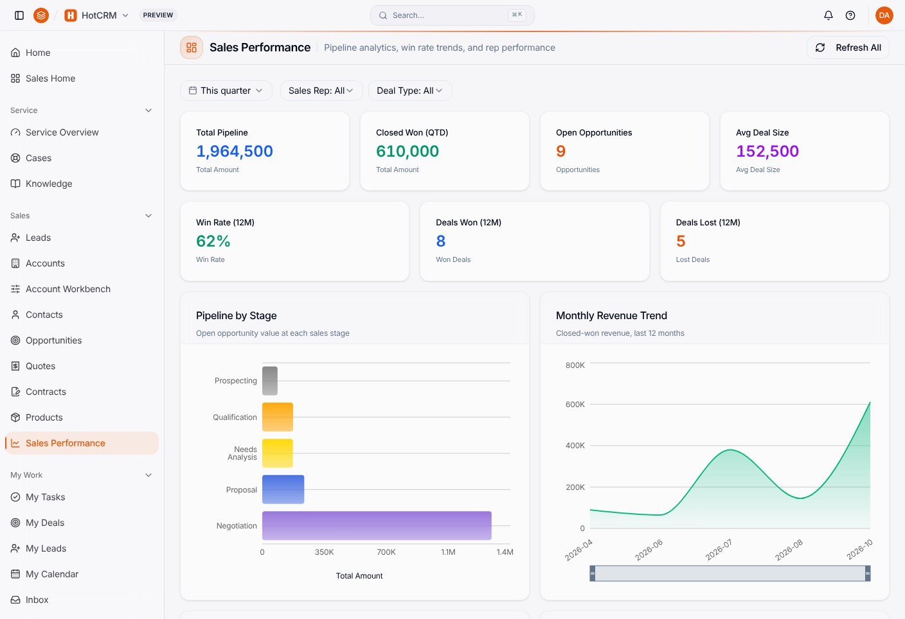
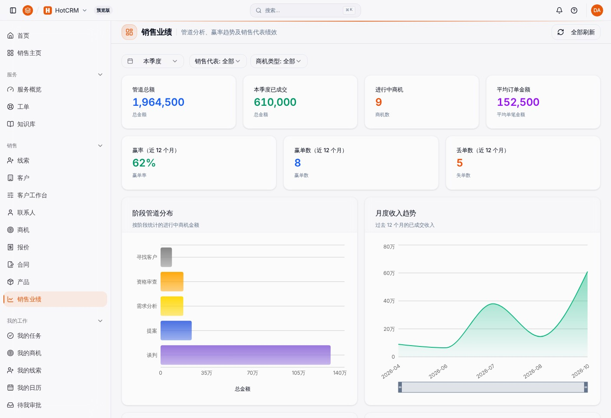

<p align="center">
  
</p>

# HotCRM

> **The ontology is the software.** One executable business ontology. AI writes it, the runtime runs it, agents operate it, you own it.
>
> 本体即软件。
>
> Ontology-driven: database, API, UI and agent tools all derive from that one definition of the business, so there is no second application to keep in step with it.

<sub>The positioning of [ObjectStack](https://github.com/objectstack-ai/objectstack), quoted as its README and the post [The Ontology Is the Software](https://objectstack.ai/blog/the-ontology-is-the-software) state it.</sub>

**HotCRM is the reference implementation of that statement for a CRM.**

- **Its business ontology is the app.** 18 business objects and the relations between them, **32 actions**, 33 flows, 6 permission sets, 12 positions and 11 sharing rules, and 6 AI skills — typed [ObjectStack](https://github.com/objectstack-ai/objectstack) metadata under `src/`, checked by `pnpm validate`.
- **The database, the API, the console UI and the agent tools derive from it.** One `pnpm dev` boot creates the tables, serves the REST API at `/api/v1/data/crm_account` and its siblings, the Console at `/_console/`, and an MCP server at `/api/v1/mcp`. Nothing under `src/` defines a route handler or a React component.
- **Views, dashboards and translations are projections of it.** List views, record pages, 5 dashboards and the app's navigation, in 4 languages (en, zh-CN, es-ES, ja-JP): the surfaces people use the ontology through, not a second copy of it.

> [!NOTE]
> **Small enough for an agent to hold whole.** The sales package carries its whole business semantics (objects, flows, actions, hooks) in **~58k tokens**, and its whole interaction layer (views, pages, dashboards, app shell) in another **~29k**.
> Measured, not estimated: `node scripts/check-source-token-ratchet.mjs` prints both figures, and every other package's, and CI fails when a package's business semantics, interaction layer or authored total grows past its committed ceiling. Comments and blank lines are stripped; translations and seed data are outside the count — a fifth locale is not business logic.

[](LICENSE)
[](src/sales/index.ts)
[](CHANGELOG.md)
[](https://cloud.objectos.app)

Install it into an ObjectStack environment from the [marketplace](https://cloud.objectos.app), or fork it and build & ask with Claude Code or any coding agent: the agent writes the metadata in your repo, and operates the running app over MCP.

---

## 📸 Projections of one ontology

Captured on ObjectStack 18.0.0 from a fresh database with the shipped seed data and demo staff (`pnpm demo:staff`), in the Console's default light theme.

| Strategic account 360 | Qualified lead workspace |
|---|---|
|  |  |

| Sales pipeline kanban | Quote lifecycle pipeline |
|---|---|
|  |  |

| Campaign lifecycle and ROI | Large-deal approval flow |
|---|---|
|  |  |

The same dashboard, two projections: the English UI and the zh-CN language pack over the same records.

| Sales performance dashboard (en) | 销售业绩仪表盘 (zh-Hans) |
|---|---|
|  |  |

> The screenshots live in `assets/screenshots/hotcrm/<screen>/<locale>.png` (`.jpg` for the sales dashboard), each with a colocated `meta.yaml` recording its purpose, alt text, capture context and platform version. This README uses English; the documentation site also publishes the `zh-Hans` variants.

---

## 🤖 Agents operate it

The runtime serves HotCRM as an MCP server at `/api/v1/mcp`, on by default. `list_objects` returns every `crm_*` object, the runtime's record tools (`query_records`, `create_record`, …) act on them, and two of HotCRM's actions opt in with `ai: { exposed: true }`: **Convert Lead** and **Schedule Follow-up**. An agent calls them under the permission sets and sharing rules of the identity it connects as — the same ones a REST call from that identity runs under.

Measured on a local community-edition boot (`pnpm dev`, then `pnpm demo:staff`). Sign in and mint an API key for an identity:

```bash
curl -c admin.txt -X POST http://localhost:4001/api/v1/auth/sign-in/email \
  -H 'content-type: application/json' -d '{"email":"admin@objectos.ai","password":"admin123"}'
curl -b admin.txt -X POST http://localhost:4001/api/v1/keys     # → { "data": { "key": "osk_…", … } }
```

Then send an agent's `tools/call` with that key:

```bash
curl -X POST http://localhost:4001/api/v1/mcp \
  -H 'content-type: application/json' -H 'accept: application/json, text/event-stream' \
  -H 'x-api-key: osk_…' \
  -d '{"jsonrpc":"2.0","id":1,"method":"tools/call","params":{"name":"create_record","arguments":{"objectName":"crm_campaign","data":{"name":"Agent-created Q1 Webinar","type":"webinar","status":"planning","start_date":"2027-01-12","end_date":"2027-01-14"}}}}'
```

| The key belongs to | What comes back |
|---|---|
| the dev admin, `admin@objectos.ai` | `isError: false` — the new campaign, `created_by` the dev admin |
| the demo sales rep Nina Reyes, `na.rep@objectos.ai` — her `sales_rep` permission set reads every campaign and grants no create | `isError: true` — `PERMISSION_DENIED`, `status: 403`, and the campaign count does not move |

HotCRM defines no agent of its own; its 6 AI skills are metadata for a platform agent to carry, and this community-edition boot runs none (`GET /api/v1/ai/agents` answers an empty list), so the agent is the one you connect. `pnpm dev` prints the `claude mcp add …` line for an MCP client; [Connect an MCP Client](https://objectstack.ai/docs/ai/connect-mcp) covers the browser sign-in and API keys.

---

## ✨ What you get

**18 business objects** across four business domains — sales, service, revenue and marketing; the repository layout below says what each package covers, and the roster itself is `src/*/objects/*.object.ts`. Around them: **32 actions**, 33 flows, **5 dashboards**, 10 reports, 9 datasets, 6 AI skills, 4 language bundles (en, zh-CN, es-ES, ja-JP), 6 permission sets, 12 positions and 11 sharing rules. `pnpm build` prints most of these counts on every build.

> **Business reader?** The ObjectStack docs tour every one of these capabilities in plain business language — [What Can It Do?](https://objectstack.ai/docs/capabilities) — with HotCRM as the running example on every page.

---

## 🚀 Install from the marketplace (recommended)

1. Sign in at [cloud.objectos.app](https://cloud.objectos.app).
2. Open **Marketplace → HotCRM** and click **Install** into your environment.
3. Open your environment URL — HotCRM is wired into the Studio shell. Done.

> First-time on ObjectStack? Create an environment from the **Starter** template first, then install HotCRM on top.

---

## 🛠 Run locally (development / fork it)

```bash
git clone https://github.com/objectstack-ai/hotcrm.git
cd hotcrm
pnpm install
pnpm dev                    # ObjectStack runtime starts at http://localhost:4001
pnpm demo:staff             # optional, in a second terminal: the demo sales and service team
```

```bash
pnpm typecheck              # strict TypeScript
pnpm build                  # produces dist/objectstack.json (the publishable artifact)
```

The compiled `dist/objectstack.json` **is** the package — that's what gets uploaded to the marketplace.

---

## 📦 Publish a fork to the marketplace

After you've forked, customized, and renamed the package:

```bash
# 1. Authenticate once (writes ~/.objectstack/cloud.json)
objectstack cloud login

# 2. Build the artifact
pnpm build

# 3. Publish a new version
objectstack package publish dist/objectstack.json \
  --manifest-id app.acme.crm \
  --version 2.2.2 \
  --display-name "Acme CRM" \
  --category crm \
  --visibility marketplace \
  --note "Initial release"
```

The CLI is idempotent: re-running with the same `--manifest-id` updates the package; new `--version` values create immutable versioned snapshots.

See [docs: Publishing your first marketplace app](content/docs/marketplace/publishing-your-first-app.mdx) for the full walkthrough.

---

## 🏗 Repository layout

```
hotcrm/
├── objectstack.config.ts         # composeStacks() — one artifact carrying the four package stacks
├── objectstack.composition.ts    # the four package stacks built, and the composition knob
├── src/
│   ├── sales/                    # the `type: app` package — customers, pipeline, activities, contracts
│   ├── service/                  # the service module — cases and the knowledge base
│   ├── revenue/                  # the revenue module — products, quotes, line items
│   ├── marketing/                # the marketing module — campaigns and campaign members
│   └── docs/                     # package docs, shipped inside the built artifact
├── apps/docs/                    # Fumadocs site — standalone, own lockfile (not a pnpm workspace member)
└── content/docs/                 # Documentation content
```

Metadata files are named **`<name>.<kind>.ts`** — `lead.object.ts` with its hooks beside it in `lead.hook.ts`, `lead.view.ts`, `lead_detail.page.ts`, `opportunity-approval.flow.ts`; actions are the one plural, `lead.actions.ts` — and a few shared files are not (`_hook-api.ts`, `positions.ts`). The `crm_` prefix on object names is explicit in source — no runtime magic.

---

## 📚 Documentation

- **Live docs:** start `pnpm -C apps/docs install && pnpm -C apps/docs dev -p 3001`, then open <http://localhost:3001/docs>
- **For business users:** Sales, Service, Marketing, Revenue, AI Copilot guides
- **For developers:** Architecture, Customization, API reference, Testing & CI
- **For publishers:** Marketplace publishing guide

---

## 🤝 Why fork HotCRM?

Because it is the platform's reference implementation — ObjectStack's North Star names it so (「参考实现 hotcrm」) — and it applies these conventions to a real CRM:

- ✅ `crm_` namespace prefix on every object (explicit, grep-able)
- ✅ Strict `*.object.ts` / `*.hook.ts` / `*.actions.ts` separation of concerns
- ✅ All metadata validated against `@objectstack/spec` schemas
- ✅ ObjectQL only — no raw SQL anywhere
- ✅ Agent-operable — every object over MCP, actions exposed to agents only where declared
- ✅ Four-language i18n out of the box
- ✅ Permission sets, positions and sharing rules that `pnpm demo:staff` staffs with a demo team and then verifies, identity by identity

If you want to ship an HR app, a project tracker, a help-desk — start by reading HotCRM's structure, then change names.

---

## 📄 License

Apache-2.0. See [LICENSE](LICENSE).
