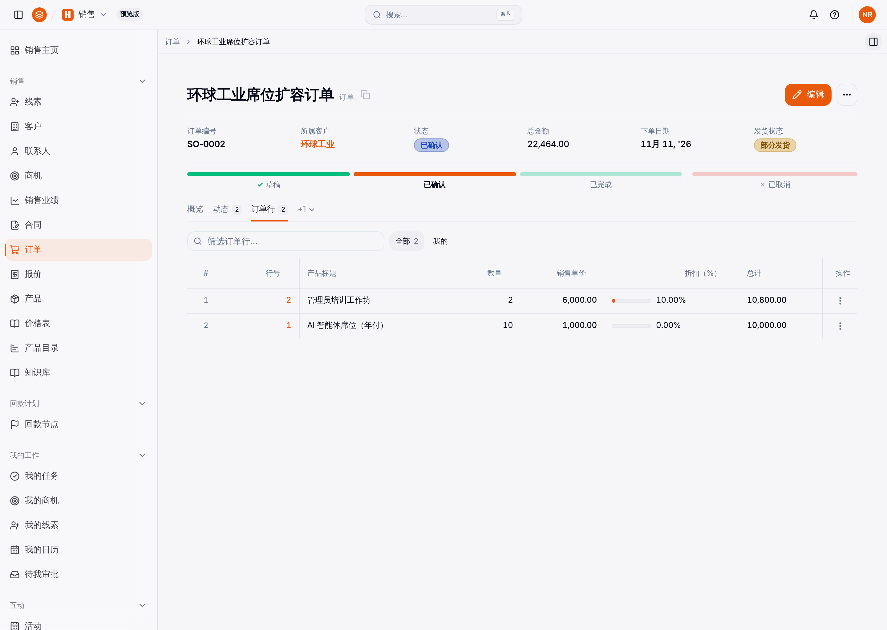
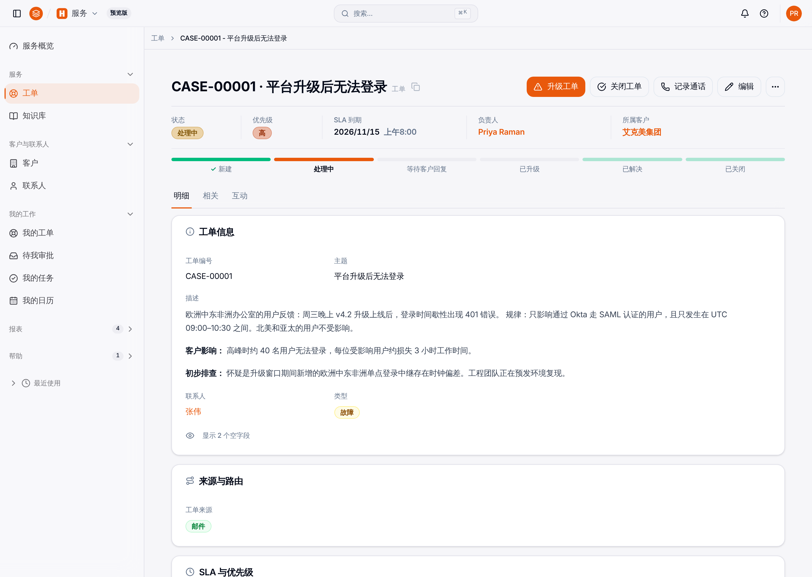
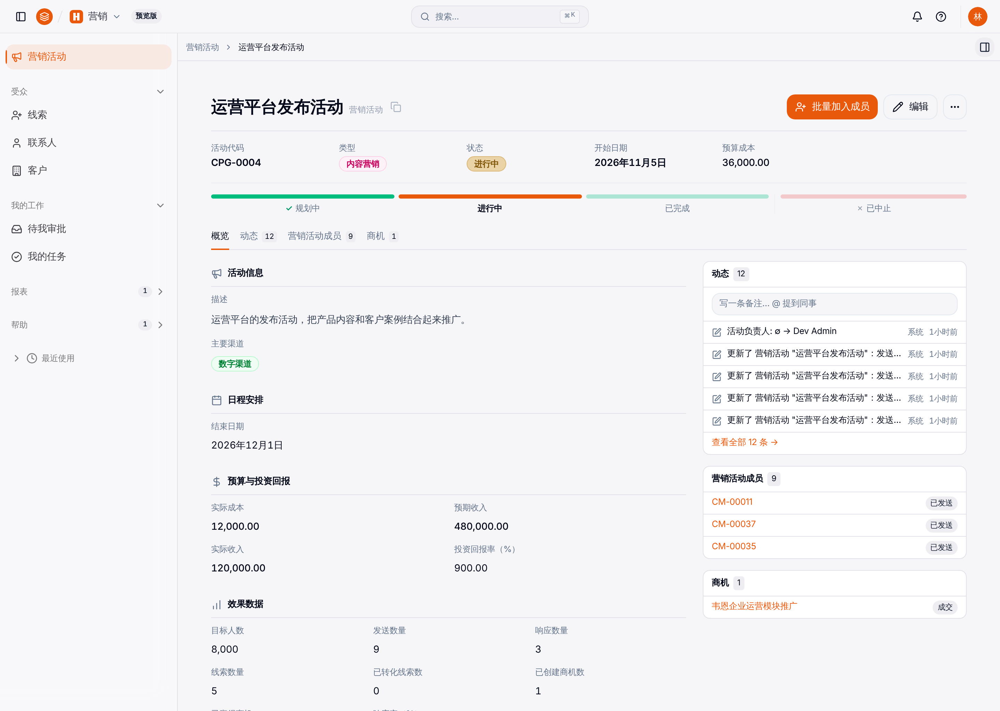
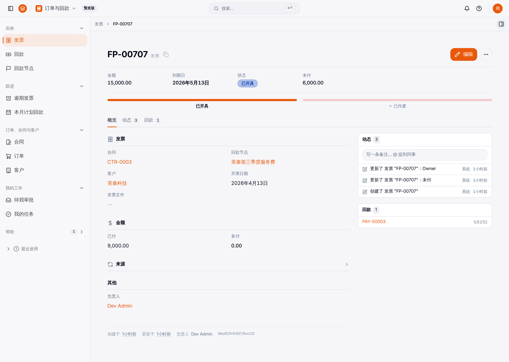
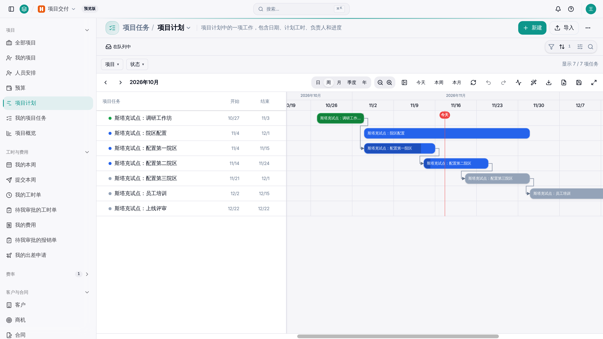
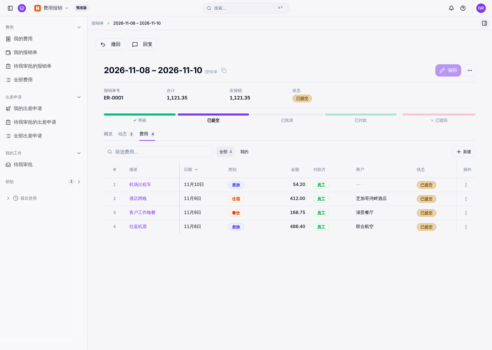

# HotCRM

<p align="center">
  
</p>

<!-- shared:headline -->

**线索、订单、项目、回款、报销，一套开源的业务系统**

业务变了，让 AI 帮你改系统；你的 AI 助手用你的权限替你办事。

<!-- /shared:headline -->

[](LICENSE)
[](src/sales/index.ts)
[](CHANGELOG.md)
[](https://cloud.objectos.ai)

[文档](https://hotcrm.com/zh-Hans/docs) · [应用市场](https://cloud.objectos.ai) · [English](https://github.com/objectstack-ai/hotcrm/blob/main/README.md)

---

<!-- section:who -->
## 适合谁

销售产品、项目服务或订阅的公司，希望销售、服务、交付和财务在同一套系统里完成。三个示例场景从头到尾走完整条链：

- [一次产品销售](https://hotcrm.com/zh-Hans/docs/getting-started/scenario-product-sale)：线索、商机、报价单、订单、合同、发票和回款，以及每一步在哪里交接。
- [项目服务](https://hotcrm.com/zh-Hans/docs/getting-started/scenario-project-services)：交易、合同及其回款计划，带着计划、预算、工时单和费用的项目，以及财务记录的发票。
- [一份订阅](https://hotcrm.com/zh-Hans/docs/getting-started/scenario-subscription)：带条款和续约的合同、每个周期一步的回款计划、发票，以及续约商机。

<!-- section:chain -->
## 从第一条线索到回款，一条链

<!-- shared:chain -->

[线索](https://hotcrm.com/zh-Hans/docs/sales/leads) → [商机](https://hotcrm.com/zh-Hans/docs/sales/opportunities) → [报价](https://hotcrm.com/zh-Hans/docs/sales/quotes) → [订单](https://hotcrm.com/zh-Hans/docs/sales/orders) → [合同或项目](https://hotcrm.com/zh-Hans/docs/sales/contracts) → [发票与回款](https://hotcrm.com/zh-Hans/docs/order-to-cash/invoices-and-payments)

[项目上已批准的工时、差旅和费用计入项目成本，毛利按客户实际支付的金额来衡量。](https://hotcrm.com/zh-Hans/docs/projects/time-and-expenses)

<!-- /shared:chain -->

从第一条线索到最后一笔回款都是同一份数据：不需要从一个系统导出、再导入下一个系统。

<!-- section:apps -->
## 六个应用

<!-- shared:apps -->

每个人打开与自己工作对应的应用。销售始终都在；其他五个管理员可以停用。

| 应用 | 适用于 | 做什么 |
| --- | --- | --- |
| [销售](https://hotcrm.com/zh-Hans/docs/sales) | 销售代表和销售经理 | 线索、客户、商机、报价与产品、订单和合同。 |
| [服务](https://hotcrm.com/zh-Hans/docs/service) | 客服人员和客服经理 | 带 SLA 和升级的工单，以及知识库。 |
| [营销](https://hotcrm.com/zh-Hans/docs/marketing) | 市场人员 | 营销活动，以及它们触达的线索和联系人。 |
| [订单与回款](https://hotcrm.com/zh-Hans/docs/order-to-cash) | 财务 | 每个客户的回款计划，以及发票和回款，有没有合同都可以。 |
| [项目交付](https://hotcrm.com/zh-Hans/docs/projects) | 项目经理、顾问和财务 | 项目、人员安排、计划、工时单和预算，以及成本和毛利。 |
| [费用报销](https://hotcrm.com/zh-Hans/docs/expenses) | 每一位员工 | 带票据的费用、报销单、出差申请及其审批。 |

<!-- /shared:apps -->

<!-- section:screenshots -->
## 截图

每个应用一张，在 ObjectStack 18.5.0 上从全新数据库加载内置示例数据和演示团队（`pnpm demo:staff`）后截取。

| 销售：销售订单及订单行 | 服务：客服工单 |
| --- | --- |
|  |  |

| 营销：营销活动生命周期与投资回报率 | 订单与回款：发票与回款 |
| --- | --- |
|  |  |

| 项目交付：甘特图上的项目计划 | 费用报销：费用报销单及其费用明细 |
| --- | --- |
|  |  |

<!-- section:ai -->
## AI 与智能体

HotCRM 的每个对象都通过 MCP 开放，每个环境的地址都是 `/api/v1/mcp`。你的智能体以某个人的身份接入（浏览器登录，或使用这个人的 API 密钥），在这个人的权限集、岗位和共享规则下工作：这个人会被拒绝的操作，智能体同样被拒绝，返回同样的错误码和提示。

HotCRM 以智能体为先。它提供对象、动作和技能；识别票据、检查报销标准、催收回款，是你自己的智能体通过 MCP 完成的工作。社区版不自带助手，由你接入自己的智能体。HotCRM 为平台助手提供 **8 个技能**（在运行助手的环境里使用），并向智能体开放 **9 个动作**，其中包括「转化线索」和「提交报销」；不可撤销、或会把记录送交审批人的动作，会先征得本人确认。

[接入你的智能体](https://hotcrm.com/zh-Hans/docs/ai-copilot/connect-your-agent) 介绍接入地址、登录方式、智能体可用的工具，以及两个权限不同的人发出同一个调用时的结果。

<!-- section:install -->
## 试用与安装

**从应用市场安装。** 在 [cloud.objectos.ai](https://cloud.objectos.ai) 登录，在应用市场中打开 HotCRM，安装到你的环境。第一次使用 ObjectStack？先用 Starter 模板创建一个环境。

**在本机运行，三条命令**（Node.js 22 或更高版本，以及 pnpm 10）：

```bash
git clone https://github.com/objectstack-ai/hotcrm.git && cd hotcrm
pnpm install
pnpm dev
```

打开 <http://localhost:4001/_console/>，用 `admin@objectos.ai` / `admin123` 登录，这是开发服务器在空数据库上创建的管理员。示例数据在首次启动时加载；在第二个终端运行 `pnpm demo:staff` 可加入演示团队。

<!-- section:customize -->
## 用 AI 定制

定义就是应用。对象和字段、规则、界面、流程、权限和翻译都是 `src/` 下的类型化元数据：在那里改一个字段，数据表、API 和界面随之一起变，没有第二套应用需要同步。像 Claude Code 这样的 AI 编程智能体在你的仓库副本里写下这次改动，`pnpm validate` 在发布前按平台的 schema 检查它。

目前这份定义包含 **38 个业务对象**、**56 个动作**、**55 个流程**、**7 个仪表盘**、**11 个数据集**和 **18 个岗位**，支持 **4 种语言**（en、zh-CN、es-ES、ja-JP）。

HotCRM 构建在 [ObjectStack](https://github.com/objectstack-ai/objectstack) 之上：这个开源平台把一份业务定义同时运行为数据库、API、界面和智能体工具。[定制与扩展](https://hotcrm.com/zh-Hans/docs/developers/customize-and-extend) 演示了一次改动的全过程。

<!-- section:developers -->
## 开发者

HotCRM 是一个由七个包组成的制品：「销售」应用，以及管理员可以停用的六个模块（[启用和停用模块](https://hotcrm.com/zh-Hans/docs/administration/modules)）。

```
hotcrm/
├── objectstack.config.ts         # composeStacks()：一个制品，承载七个包的 stack
├── objectstack.composition.ts    # 构建好的各个包 stack
├── src/
│   ├── sales/                    # 应用包：客户、联系人、线索、商机、订单、合同、活动
│   ├── service/                  # 模块：工单、SLA、知识库
│   ├── revenue/                  # 模块：产品、价格表、报价单（显示在「销售」里）
│   ├── marketing/                # 模块：营销活动及其成员
│   ├── o2c/                      # 模块：回款计划、发票、回款（订单与回款）
│   ├── psa/                      # 模块：项目、人员安排、计划、工时单、预算（项目交付）
│   ├── expense/                  # 模块：费用、报销单、出差申请
│   └── docs/                     # 应用内手册，随制品一起发布
├── apps/docs/                    # 文档站点，发布在 https://hotcrm.com/docs
└── content/docs/                 # 文档内容：en、zh-Hans、zh-Hant
```

```bash
pnpm dev            # 应用运行在 http://localhost:4001
pnpm verify         # validate、typecheck、lint、hygiene、build 和 test：提交拉取请求前运行
pnpm build          # dist/objectstack.json，应用市场安装的制品
pnpm docs:product   # 修改应用或 apps/docs/lib/product/product.json 后，重写共享的产品区块
```

第一次提交拉取请求前请阅读 [CONTRIBUTING](https://github.com/objectstack-ai/hotcrm/blob/main/CONTRIBUTING.md)；架构、API、测试，以及[把你自己的副本发布到应用市场](https://hotcrm.com/zh-Hans/docs/developers/publishing-your-first-app)，见文档的[开发者](https://hotcrm.com/zh-Hans/docs/developers)部分。

<!-- section:license -->
## 许可

Apache-2.0，与 ObjectStack 相同。见 [LICENSE](https://github.com/objectstack-ai/hotcrm/blob/main/LICENSE)。
