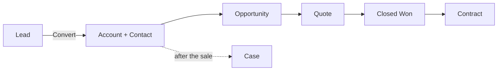

# HotCRM Overview

HotCRM runs your customer lifecycle across four areas. The screens are
self-explanatory — this manual covers what the screens **don't** show: the
rules and automation working behind the scenes (who a record routes to, when
something escalates, what threshold triggers an approval).

## The four areas

- **Sales** — leads, accounts, contacts, opportunities and contracts: the
  motion from a first enquiry to a signed agreement and its renewal.
- **Service** — cases and the knowledge base: support after the sale, with
  SLA clocks and escalation.
- **Revenue** — products, price books and quotes: what a deal is priced at.
  It is an add-on module with a manual of its own under **Help**.
- **Marketing** — campaigns and their members: where leads come from. It is
  an add-on module too.

## The customer lifecycle, end to end

A customer moves through the areas like this:

Most of what makes HotCRM useful is **automatic**: a new lead gets a follow-up
deadline and lands with a rep without anyone configuring it; a deal over a
threshold halts for sign-off; a case that misses its SLA escalates on its own
once the deployment switches scheduled work on. The guides below document each
of those behaviors and the exact thresholds, so nothing the system does is a
surprise.

## Which guide to read

| You are | Read |
|---|---|
| A sales rep or sales manager | [Leads](./crm_sales_leads.md), [Opportunities](./crm_sales_opportunities.md) and [Contracts](./crm_sales_contracts.md) |
| A service agent or service manager | [Cases & SLAs](./crm_service_cases.md) and [Knowledge](./crm_service_knowledge.md) |
| Building quotes | the **Revenue Manual** under **Help** |
| An administrator | the **Admin Manual** under **Help**: who sees whose records, and where every threshold is tuned |

Tuning any of these rules (approval amounts, SLA timing, stale-deal windows)
is an administrator task, so ask your administrator when a number here does
not fit your business.
