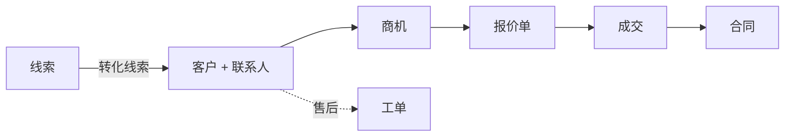

# HotCRM 概览

HotCRM 用四个业务领域承载完整的客户生命周期。界面本身一看就懂——这本手册讲的是界面**看不出来**的东西：在后台自动运行的规则（记录分给谁、什么时候升级、多大金额触发审批）。

## 四个业务领域

- **销售**——线索、客户、联系人、商机和合同：从第一次咨询走到签约，再到续约。
- **服务**——工单和知识库：售后支持，带 SLA 计时和自动升级。
- **收入**——产品、价格表和报价单：一笔交易按什么价格报给客户。它是一个附加模块，在**帮助**下有自己的手册。
- **市场营销**——营销活动及其成员：线索从哪里来。它同样是一个附加模块。

## 客户生命周期全貌

客户在各领域之间这样流转：

HotCRM 最有用的部分是**自动**发生的：新线索不需要任何人配置，就会拿到跟进期限并分到一位销售代表手里；超过金额门槛的商机会停下来等待签批；工单错过 SLA 后，只要部署开启了计划任务，就会自动升级。下面的指南逐一记录这些行为和确切的门槛，系统做的任何事都不会让你意外。

## 该读哪一篇

| 你是 | 请读 |
|---|---|
| 销售代表或销售经理 | [线索](./crm_sales_leads.md)、[商机](./crm_sales_opportunities.md) 和 [合同](./crm_sales_contracts.md) |
| 客服专员或服务经理 | [工单与 SLA](./crm_service_cases.md) 和 [知识库](./crm_service_knowledge.md) |
| 需要制作报价单 | **帮助**下的**收入手册** |
| 管理员 | **帮助**下的**管理员手册**：谁能看到谁的记录，以及每个门槛在哪里调整 |

调整这些规则（审批金额、SLA 时长、停滞商机的天数）属于管理员的工作；如果这里的某个数字不适合你的业务，请联系你的管理员。
