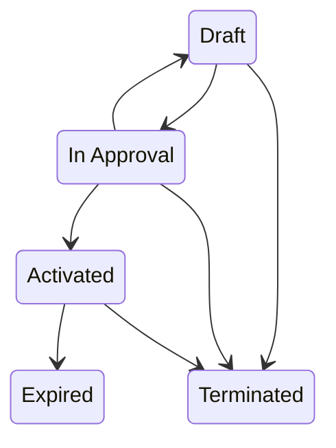

# Contracts — Renewals & Expiration

For sales representatives and sales managers. Closing a deal isn't the end of
the relationship — it's the start of a contract you'll eventually renew.

## Contract status

A contract moves through these statuses, and only along these arrows: any
other status change is refused when you save. **Expired** and **Terminated**
are final — a renewal is a new contract.

## A contract's name

Every contract has a **Contract Name**, and it is the contract's title in
lists, pickers, approvals and notices; its **Contract Number** stands beside
it, and a picker shows the number under each name. A contract drafted from an
order is named as the order is, so one drafted from an accepted quote's order
carries the quote's name. Change it to whatever the customer calls the
agreement.

## Printing a contract and filing the signed copy

**Print Contract**, on the contract and in the contract list's row menu, prints
the contract as a document — the parties, the term, the value and billing, the
renewal terms and a signature block for each side — and files the PDF under the
contract's **Attachments**, in your name. It is offered to whoever may edit the
contract and attach files to it. Printing changes nothing else on the contract,
so print it as often as you need.

When the customer sends the contract back signed, upload it to the contract's
**Signed Copy**. If **Signed Date** is empty, it is filled with today's date on
that save; a date that is already there is kept, so type the real signing date
when it was another day.

**A contract is activated only with its signed copy.** The save that moves a
contract to **Activated** is refused, naming **Signed Copy**, until the file is
there, and the file cannot be removed from an activated contract. A contract
that was already activated before this rule still expires or is terminated as
before, and an import or an integration still saves its other changes. The
**Edit** form asks for the **Signed Copy** before it saves any change to such a
contract, so upload the copy first.

## Order contracts, framework contracts and other

A contract's **Contract Form** says where its value comes from. **Draft
Contract** on an order makes an **order contract**: its value is the order's
total, tax included, and while the contract is a draft it follows the order —
change the order and the contract's value changes with it. Nobody types an
order contract's value. A contract you create by hand is a **framework
contract** (its value typed, and it may carry many orders) or **Other** (no
amount, such as an NDA); you choose while it is a draft.

Once an order contract is activated, its value stays as signed. If the order
changes afterwards, the contract shows **Differs from the Order Amount**.

## A framework contract's quota

A framework contract's value is a ceiling for the orders placed under it. Its
**Order Totals** show how far the orders have gone: **Order Amount** is the
total of every order linked to the contract, tax included, whatever the
order's status, and **Remaining Quota** is the contract value less that
amount. Remaining Quota below zero means the orders have gone over.

Linking an order to a framework contract, or raising a linked order's total,
so that the orders go over the contract value saves the order and shows a
warning. An edit that does not add to the order's total, or lowers it, gives
no warning. An order line that takes its order over saves without the
warning; the contract's Remaining Quota shows it. The quota is the contract's
current value: once Change gives an activated contract a new value, Remaining
Quota counts from it.

## Changing an activated contract

An activated contract's **Contract Value**, **End Date** and **Payment Terms**
change only through **Change**: give the reason and upload the signed
amendment, or nothing is saved. On an order contract, **Update from Order**
takes the order's current amount; no value is typed. The contract stays
activated, and its history keeps every value before and after, with who
changed it and when.

## Renewals and expiration are watched for you

Two automatic jobs make sure a contract never lapses unnoticed, on a deployment
that has switched scheduled work on. A default install boots both unbound: no
renewal task, notification or deal is created, and an activated contract past
its end date stays activated until someone changes it.

### Renewal reminders (automatic)

Each contract carries its own **Renewal Notice Days** — how far ahead to start
the renewal conversation. It can be at most **120 days**, because the sweep looks
120 days ahead: a longer window could not fire on time, so a save asking for one
is refused. A daily sweep finds **activated** contracts whose
**end date** has entered that notice window and:

- creates a **high-priority renewal task** for the owner (due on the contract's
  end date), and
- notifies the owner to start the renewal conversation.

### Auto-renewal → a deal already in your pipeline (automatic)

If a contract has **Auto-Renewal** switched on, the same sweep also opens a
renewal **opportunity** (type *Existing Customer — Renewal*), pre-filled from
the contract value — so the renewal is already sitting in your pipeline to work,
not something you have to remember to create.

### Expiration (automatic)

A contract that passes its **end date** without being renewed is automatically
marked **Expired**, and the owner is notified. Renew before the end date to
avoid the lapse.

---

**Related:** the deal a contract comes from — see
[Opportunities](./crm_sales_opportunities.md).
