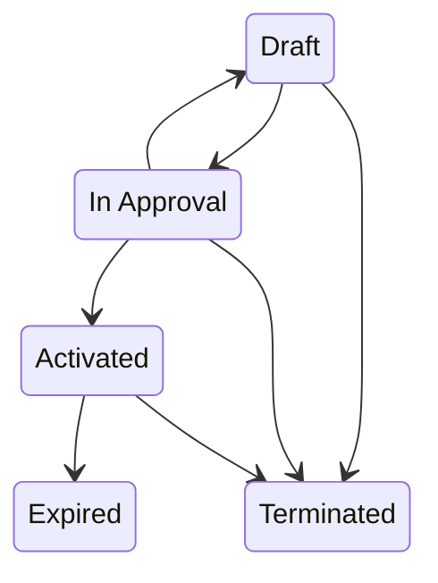

# Contracts — Renewals & Expiration

For sales representatives and sales managers. Closing a deal isn't the end of
the relationship — it's the start of a contract you'll eventually renew.

## Contract status

A contract moves through these statuses, and only along these arrows: any
other status change is refused when you save. **Expired** and **Terminated**
are final — a renewal is a new contract.

## Renewals and expiration are watched for you

Two automatic jobs make sure a contract never lapses unnoticed, on a deployment
that has switched scheduled work on. A default install boots both unbound: no
renewal task, notification or deal is created, and an activated contract past
its end date stays activated until someone changes it.

### Renewal reminders (automatic)

Each contract carries its own **Renewal Notice Days** — how far ahead to start
the renewal conversation. A daily sweep finds **activated** contracts whose
**end date** has entered that notice window and:

- creates a **high-priority renewal task** for the owner (due on the contract's
  end date), and
- notifies the owner to start the renewal conversation.

### Auto-renewal → a deal already in your pipeline (automatic)

If a contract has **Auto-Renewal** switched on, the same sweep also opens a
renewal **opportunity** (type *Existing Customer — Renewal*), pre-filled from
the contract value — so the renewal is already sitting in your pipeline to work,
not something you have to remember to create.

### Expiration (automatic)

A contract that passes its **end date** without being renewed is automatically
marked **Expired**, and the owner is notified. Renew before the end date to
avoid the lapse.

---

**Related:** the deal a contract comes from — see
[Opportunities](./crm_sales_opportunities.md).
