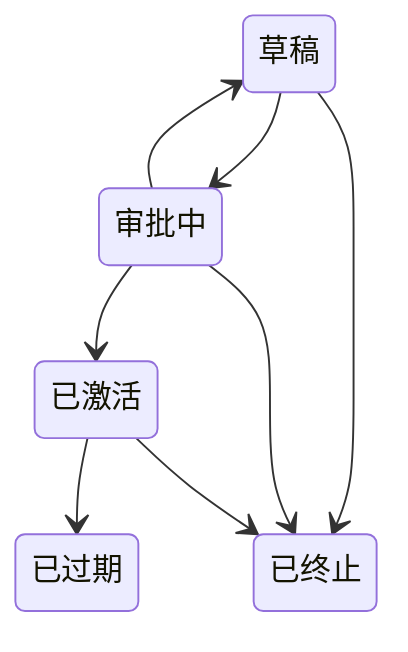

# 合同——续约与到期

面向销售代表和销售经理。成交不是客户关系的终点——它是一份你迟早要续约的合同的起点。

## 合同状态

合同只能沿下图变更状态：其他任何状态变更在保存时都会被拒绝。**已过期**和**已终止**是最终状态——续约是一份新合同。

## 续约和到期由系统替你盯着

在开启了计划任务的部署上，两个自动任务确保合同不会在无人察觉时失效。默认安装启动时这两个任务都未绑定：不会创建续约任务、通知或商机，已过结束日期的已激活合同会一直保持已激活，直到有人修改它。

### 续约提醒（自动）

每份合同都有自己的**续约通知（天）**——提前多少天开始谈续约。每日扫描会找出**结束日期**已进入该通知窗口的**已激活**合同，并且：

- 为负责人创建一条**高优先级续约任务**（截止日期为合同的结束日期），以及
- 通知负责人开始谈续约。

### 自动续约 → 一笔已经在你管道里的商机（自动）

如果合同开启了**自动续约**，同一次扫描还会新建一笔续约**商机**（类型为*老客户续约*），按合同金额预先填好——续约已经在你的管道里等你推进，而不是需要你记着去创建。

### 到期（自动）

过了**结束日期**仍未续约的合同会被自动标记为**已过期**，并通知负责人。在结束日期之前续约，以免失效。

---

**相关：** 合同来自哪笔商机——见[商机](./crm_sales_opportunities.md)。
