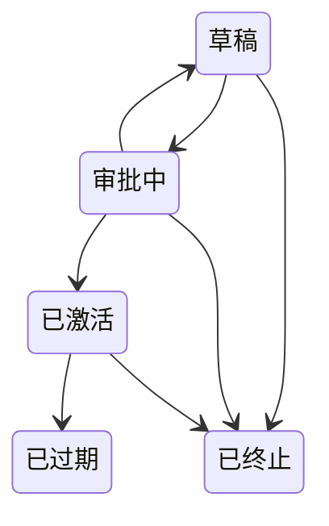

# 合同——续约与到期

面向销售代表和销售经理。成交不是客户关系的终点——它是一份你迟早要续约的合同的起点。

## 合同状态

合同只能沿下图变更状态：其他任何状态变更在保存时都会被拒绝。**已过期**和**已终止**是最终状态——续约是一份新合同。

## 合同名称

每份合同都有**合同名称**，它就是合同在列表、选择器、审批和通知里的标题；**合同编号**与它并列，选择器里每个名称下面都显示编号。从订单起草的合同与订单同名，所以从已接受报价生成的订单起草出来的合同带着报价的名称。可以把它改成客户对这份协议的叫法。

## 打印合同与归档签署副本

合同记录上和合同列表的行菜单里都有**打印合同**：它把合同打印成一份文档——签约方、期限、金额与计费、续约条款，以及双方各一栏签署栏——并以你的名义把 PDF 归档到合同的**附件**里。能编辑该合同并能为它添加附件的人才会看到这个按钮。打印不会改动合同上的其他内容，需要时可以反复打印。

客户把签好的合同寄回后，把它上传到合同的**签署副本**。如果**签署日期**为空，这次保存会把它填为当天；已经有的日期会保留，所以签署日不是今天时，请填上真实的签署日期。

**合同必须有签署副本才能激活。** 在上传文件之前，把合同改为**已激活**的那次保存会被拒绝，并指明**签署副本**；已激活合同上的这个文件也不能删除。在这条规则之前就已激活的合同照常到期或终止，导入或集成对它的其他修改也照常保存；但**编辑**表单在保存任何修改之前会先要求**签署副本**，所以请先上传副本。

## 订单合同、框架合同和其他

合同的**合同形式**说明金额从哪里来。在订单上点**起草合同**生成的是**订单合同**：
金额就是订单的含税总额，草稿期间跟随订单——改订单，合同金额随之变化。订单合同的
金额没有人手工填写。手工创建的合同是**框架合同**（金额手工填写，可挂多张订单）
或**其他**（没有金额，例如保密协议），在草稿期间选择。

订单合同激活后，金额保持签署时的数字。之后订单再变，合同上会显示**与订单金额
不一致**。

## 框架合同的额度

框架合同的金额是挂在它下面的订单的上限。合同的**订单汇总**显示订单用了多少：
**订单金额**是关联到这份合同的**已确认**和**已完成**订单的含税总额，**剩余额度**
是合同金额减去订单金额。草稿和已取消的订单都不计入，也不计入合同的未回款和未开票；
草稿订单确认后即计入。剩余额度小于零，说明订单已经超出。订单合同上的**订单金额**是
它那张订单的总额（订单已取消时除外）。

把订单关联到框架合同，或调高已关联订单的总额，使订单总额超过合同金额时，订单照常
保存，并显示一条警告。草稿订单按已确认来检查，所以还来得及修改时就会提示；确认一张
使合同超出的订单时，会再提示一次。没有增加订单总额或调低总额的修改不会警告。订单行使订单超出
时，保存不显示警告，合同的剩余额度会体现出来。额度按合同的当前金额计算：已激活合同
通过**变更**改了金额后，剩余额度按新金额计算。

## 变更已激活的合同

已激活合同的**合同金额**、**结束日期**和**付款条款**只能通过**变更**修改：填写
原因并上传签署的变更协议，否则存不下来。订单合同上用**按订单更新**取订单的当前
金额，不填写金额。合同保持已激活，它的历史记下每个值改前改后、谁改的、何时改的。

## 续约和到期由系统替你盯着

在开启了计划任务的部署上，两个自动任务确保合同不会在无人察觉时失效。默认安装启动时这两个任务都未绑定：不会创建续约任务、通知或商机，已过结束日期的已激活合同会一直保持已激活，直到有人修改它。

### 续约提醒（自动）

每份合同都有自己的**续约通知（天）**——提前多少天开始谈续约。它最多为 **120 天**，因为扫描最多往前看 120 天：更长的窗口无法按时提醒，所以填写更长天数的保存会被拒绝。每日扫描会找出**结束日期**已进入该通知窗口的**已激活**合同，并且：

- 为负责人创建一条**高优先级续约任务**（截止日期为合同的结束日期），以及
- 通知负责人开始谈续约。

### 自动续约 → 一笔已经在你管道里的商机（自动）

如果合同开启了**自动续约**，同一次扫描还会新建一笔续约**商机**（类型为*老客户续约*），按合同金额预先填好——续约已经在你的管道里等你推进，而不是需要你记着去创建。

### 到期（自动）

过了**结束日期**仍未续约的合同会被自动标记为**已过期**，并通知负责人。在结束日期之前续约，以免失效。

---

**相关：** 合同来自哪笔商机——见[商机](./crm_sales_opportunities.md)。
