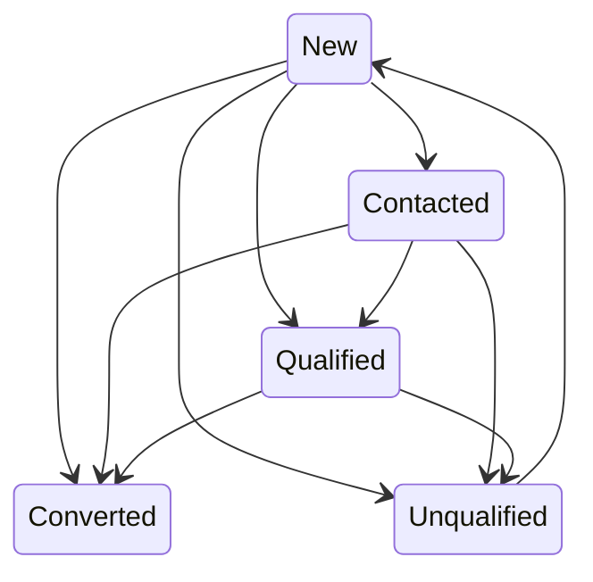

# Leads — Routing & Conversion

For sales representatives and sales managers. A lead is an enquiry that is not
yet a customer; this guide covers the rules the system applies to it
automatically, from the moment it is created to the moment it is converted.

## New leads route themselves

When a lead is created, HotCRM scores its urgency and sets a follow-up deadline
automatically:

| Lead Score | Follow-up SLA | What happens |
|---|---|---|
| **Hot** — 4★ or higher | **1 day** | The owner is alerted to *follow up within 24h*. |
| Everything else | **3 days** | The owner gets a standard follow-up deadline. |

**Lead Score** is the 1–5 star field on each lead (shown as *Lead Score* in the
UI). A score of 4★ or more marks the lead "hot" and triggers the 1-day SLA.

A lead submitted through a web-to-lead form arrives with nobody behind it, so
it is **auto-assigned to the sales rep with the fewest open leads** — a
self-balancing round-robin over everyone holding the *Sales Rep* position. Only
when no rep pool exists yet does such a lead stay ownerless for a manager to
claim.

A lead that a person puts in keeps that person as owner: one created in the UI,
one sent through the API under their sign-in or API key, and one imported from
a file. A file import never goes to the round-robin — a row with a blank owner
is owned by whoever ran the import, and the leads can be reassigned afterwards
(see the administrator's [Importing Data](./crm_admin_data_import.md) page).

## Lead status

A lead usually moves forward through these statuses. The arrows are the moves
the app treats as normal; a move off them (say, a qualified lead set back to
New) still saves, and the app only logs a warning. **Converted** is the one
status nobody sets by hand — only **Convert** sets it.

## Converting a qualified lead

Use **Convert** on a qualified lead. A short screen asks whether to create an
opportunity (and for its name and amount). On confirm, the system creates:

- an **Account** from the lead's company,
- a **Contact** from the lead's name and details, and
- optionally an **Opportunity** with the name/amount you entered.

You don't re-key anything — company and contact details carry over from the lead.
What happens to the deal next is in [Opportunities](./crm_sales_opportunities.md).
