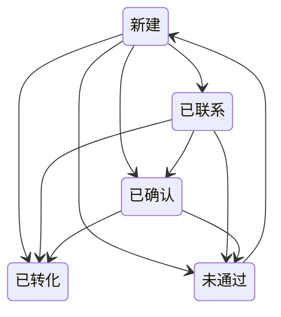

# 线索——分配与转化

面向销售代表和销售经理。线索是一次还不是客户的咨询；本指南讲的是系统从线索创建到转化期间自动对它施加的规则。

## 新线索自动分配

线索创建后，HotCRM 会自动评估它的紧急程度并设置跟进期限：

| 线索评分 | 跟进 SLA | 会发生什么 |
|---|---|---|
| **热线索**——4★ 或以上 | **1 天** | 提醒负责人在 *24 小时内跟进*。 |
| 其余线索 | **3 天** | 负责人获得一个标准的跟进期限。 |

**线索评分**是每条线索上的 1–5 星字段（界面上显示为*线索评分*）。4★ 或以上即视为"热线索"，触发 1 天的 SLA。新建线索时留空，HotCRM 会根据邮箱域名、电话、职位、行业和公司规模替你打分；你自己填写的评分会保留。

通过网页表单提交的线索（网页转线索）背后没有具体的人，所以会**自动分配给 Lead Intake（线索受理）队列成员中未转化线索最少的销售代表**——队列成员是所有持有*销售代表*岗位的人。只有队列里没有成员时，这类线索才会无人负责地在队列里等待；任何一位销售代表都可以打开它并点击**认领**接手。

由某个人录入的线索以这个人为负责人：在界面里创建的、用本人登录或 API 密钥通过 API 提交的、以及从文件导入的都是如此。文件导入从不进入队列——负责人留空的行归执行导入的人所有，之后可以再重新分配（见管理员的[导入数据](./crm_admin_data_import.md)页面）。

## 线索状态

线索通常沿下图向前推进。箭头是应用视为正常的变更；偏离箭头的变更（比如把一条已确认的线索改回新建）照样会保存，应用只记一条警告。**已转化**是唯一不能手工设置的状态——只有**转化线索**能设置它。

- **已联系自动设置。** 在新建线索上记录第一次电话、会议或邮件，线索就变为已联系。之后再记录不会改变状态，其他状态的线索也保持不变。
- **已确认需要依据。** 在线索页面点击**确认线索**：它要求填写**需求类型**和**预计金额**，两项都必填。用其他方式（编辑表单、状态条、导入或 API）设为已确认时，只要有一项为空就会被拒绝。预计金额就是转化时商机金额的预填值。
- **点状态条推进。** 点一个状态并确认，线索就移到该状态。点击和编辑一样受检查：已确认仍要两项都填，已转化仍然只能由**转化线索**设置。商机和工单页面同样可以点。

## 姓名的写法

线索和联系人的姓名由**名字**和**姓氏**两个字段组成，记录标题、列表、查找、搜索和通知显示的都是这一个姓名。**姓氏**用中文、日文或韩文书写时，姓氏在前、名字在后，中间不加空格：姓氏「张」名字「伟」显示为 **张伟**。其他姓名按「名字 空格 姓氏」显示，例如 *Ada Lovelace*。这条规则看的是姓名本身，而不是你使用的界面语言，所以每个人看到的姓名都一样。姓名随记录保存，转化时比较的也是它：邮箱相同、完整姓名相同的联系人和线索就是同一个人，不论姓名在两个字段间怎么拆——姓氏「欧阳」名字「娜娜」与姓氏「欧」名字「阳娜娜」是同一个姓名，转化不会要你确认并入。

## 转化一条已确认的线索

在已确认的线索上点击**转化线索**。一个简短的界面会问你是否同时创建商机（以及商机的名称和金额）。确认后，系统会创建：

- 由线索的公司生成的**客户**，
- 由线索的姓名和详细信息生成的**联系人**，以及
- 可选的、使用你输入的名称和金额的**商机**。如果线索响应过营销活动，商机的**营销活动**就是它最近一次响应的那个活动，活动的成果会算上这笔交易。

无需重复录入——公司和联系人信息都从线索带过来。商机接下来会经历什么，见[商机](./crm_sales_opportunities.md)。

联系人的邮箱不能重复，所以当你能看到的某个联系人已经使用线索的邮箱时，线索会并入这个联系人，而不是新建一个，转化界面会写明是哪个联系人。转化只补填这个联系人空着的**电话**、**手机**和**职位**，其他内容不变。如果这个联系人的姓名和线索不同，会多出一个界面，要求勾选**把这条线索转化到这个联系人**；不勾选就不会转化。如果这是两个不同的人，请先修改线索的邮箱。

已转化的线索会被锁定：它的页面不显示**编辑**，字段也不能在页面上直接修改。它的**转化**分组链接到它生成的客户、联系人和商机，请在那里继续工作。
