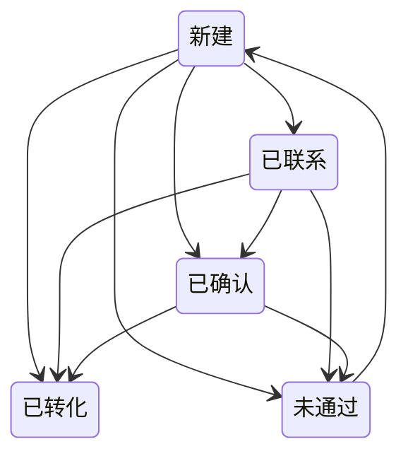

# 线索——分配与转化

面向销售代表和销售经理。线索是一次还不是客户的咨询；本指南讲的是系统从线索创建到转化期间自动对它施加的规则。

## 新线索自动分配

线索创建后，HotCRM 会自动评估它的紧急程度并设置跟进期限：

| 线索评分 | 跟进 SLA | 会发生什么 |
|---|---|---|
| **热线索**——4★ 或以上 | **1 天** | 提醒负责人在 *24 小时内跟进*。 |
| 其余线索 | **3 天** | 负责人获得一个标准的跟进期限。 |

**线索评分**是每条线索上的 1–5 星字段（界面上显示为*线索评分*）。4★ 或以上即视为"热线索"，触发 1 天的 SLA。新建线索时留空，HotCRM 会根据邮箱域名、电话、职位、行业和公司规模替你打分；你自己填写的评分会保留。

通过网页表单提交的线索（网页转线索）背后没有具体的人，所以会**自动分配给名下未结线索最少的销售代表**——在所有持有*销售代表*岗位的人之间自我均衡地轮询。只有在还没有任何销售代表时，这类线索才会暂时无人负责，等待经理认领。

由某个人录入的线索以这个人为负责人：在界面里创建的、用本人登录或 API 密钥通过 API 提交的、以及从文件导入的都是如此。文件导入从不进入轮询——负责人留空的行归执行导入的人所有，之后可以再重新分配（见管理员的[导入数据](./crm_admin_data_import.md)页面）。

## 线索状态

线索通常沿下图向前推进。箭头是应用视为正常的变更；偏离箭头的变更（比如把一条已确认的线索改回新建）照样会保存，应用只记一条警告。**已转化**是唯一不能手工设置的状态——只有**转化线索**能设置它。

## 转化一条已确认的线索

在已确认的线索上点击**转化线索**。一个简短的界面会问你是否同时创建商机（以及商机的名称和金额）。确认后，系统会创建：

- 由线索的公司生成的**客户**，
- 由线索的姓名和详细信息生成的**联系人**，以及
- 可选的、使用你输入的名称和金额的**商机**。

无需重复录入——公司和联系人信息都从线索带过来。商机接下来会经历什么，见[商机](./crm_sales_opportunities.md)。

已转化的线索会被锁定：它的页面不显示**编辑**，字段也不能在页面上直接修改。它的**转化**分组链接到它生成的客户、联系人和商机，请在那里继续工作。
