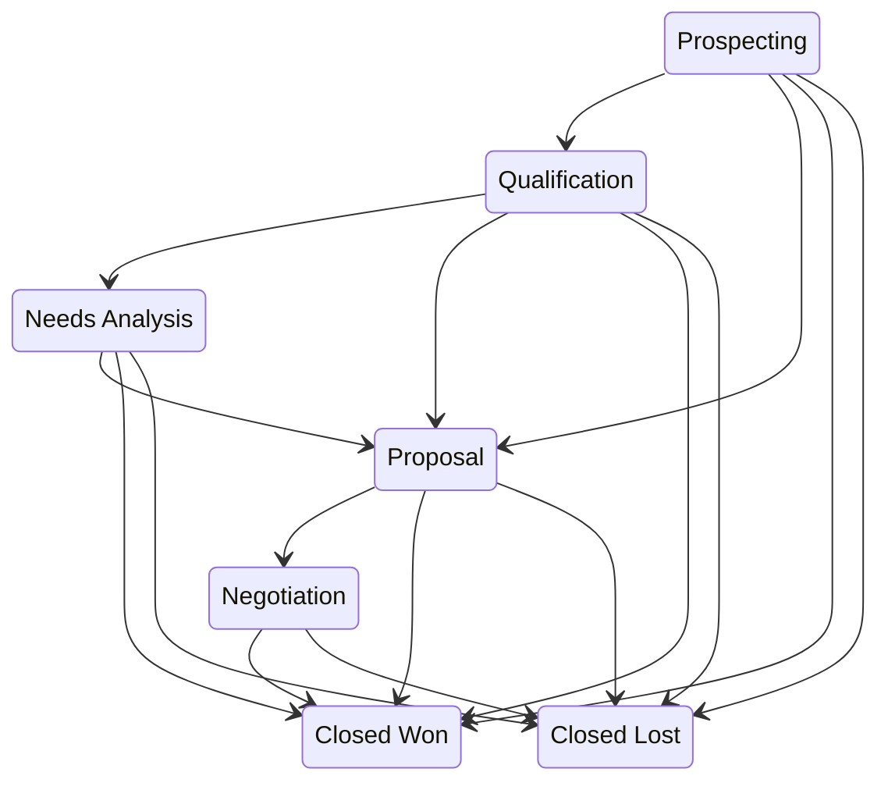

# Opportunities — Stages, Alerts & Approvals

For sales representatives and sales managers. This covers working a deal from
its first stage to a close, and — more importantly — the rules the system
applies automatically along the way.

## Stages

Opportunities advance through these stages. The arrows are the moves the app
treats as normal; a move off them still saves, and the save comes back with a
warning. Any open stage can close straight to **Closed Won** or **Closed Lost**,
so a deal won early saves without one. **Closed Won** and **Closed Lost** are
where a deal ends.

New opportunities start at **10% probability**. Keep the **amount**, **stage**,
and **close date** current — the automation below keys off all three.

## Stalled-deal nudge (automatic)

Where the deployment has switched scheduled work on (an administrator setting),
a daily **07:30** sweep finds any open opportunity that has sat in its current
stage for **more than 14 days**. The owner is notified — the owner alone, not
their manager — and a **high-priority follow-up task** is created. Advance the
stage or re-qualify the deal to clear it.

## Won-deal alert (automatic)

When a deal of **$100,000** or more is marked **Closed Won**, the owner is
notified automatically — the owner alone, not their manager. A deal at exactly
$100,000 counts: the large-deal line is inclusive everywhere.

## Large-deal approval — when a deal pauses for sign-off

Deals above a threshold **lock and wait** for approval. There is no "submit"
step — the moment a deal's **amount** reaches $100K, it routes for approval
automatically, and you can't move it forward until each required approver signs
off.

| Deal amount | Required approval |
|---|---|
| **$100,000 or more** | Sales Manager review |
| **> $500,000** | Sales Manager **and** Sales Director sign-off |

While an approval is pending, the opportunity is **locked** and its
**Approval Status** shows the live state. On full approval it is stamped
**Approved** (with date) and you're notified. On rejection it is stamped
**Rejected** — the deal is unlocked; revise it and save to resubmit, since a rejected
deal of $100K or more cannot be closed won until a new request is approved. The
submitter can also **Recall** a pending request to unlock the deal; the next save
resubmits it. Approvers act from their **Approvals → Inbox**.

---

**Related:** a deal starts life as a lead — see [Leads](./crm_sales_leads.md);
once it is won, the relationship continues as a contract — see
[Contracts](./crm_sales_contracts.md); the tasks, calls and meetings that move
it along — see [Activities](./crm_sales_activities.md).
