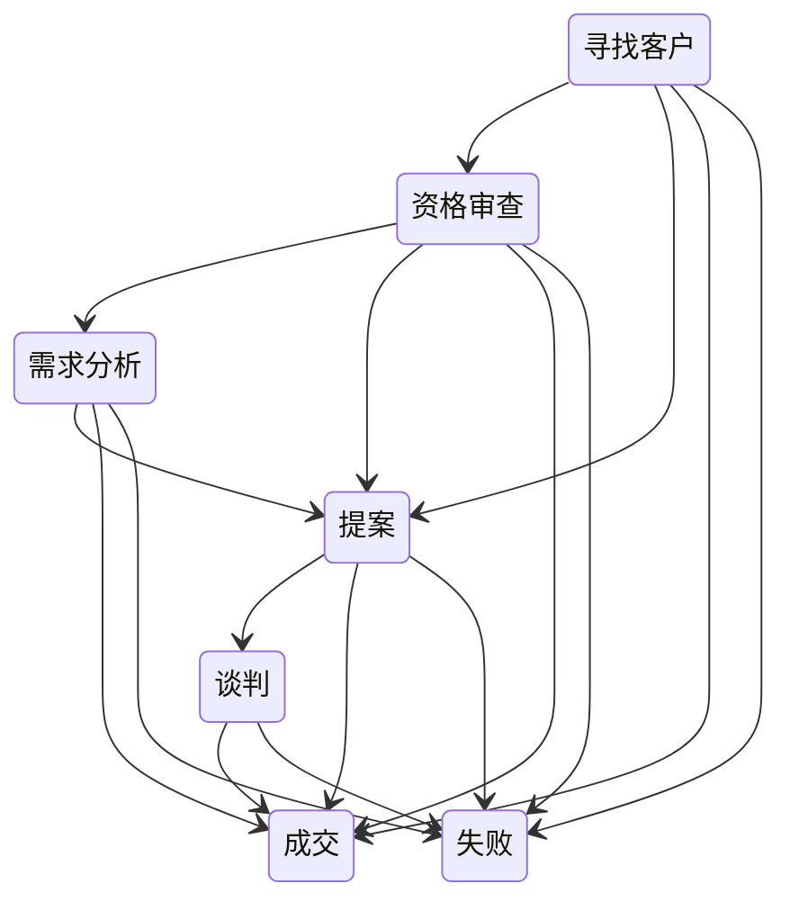

# 商机——阶段、提醒与审批

面向销售代表和销售经理。本指南讲的是一笔商机从第一个阶段走到结束的过程，更重要的是，系统在途中自动施加的规则。

## 阶段

商机沿下图推进。箭头是应用视为正常的变更；偏离箭头的变更照样会保存，保存结果会附带一条警告。任何未关闭的阶段都可以直接转为**成交**或**失败**，所以提前赢下的商机保存时不会再出现警告。**成交**和**失败**是商机的终点。

新商机的成交概率从 **10%** 开始。请及时更新**金额**、**阶段**和**预计成交日期**——下面的自动化全都依据这三项。

## 停滞商机提醒（自动）

在部署开启了计划任务（一项管理员设置）的环境里，每天 **07:30** 的扫描会找出在当前阶段停留**超过 14 天**的未结商机。系统会通知负责人——只通知负责人本人，不通知其经理——并创建一条**高优先级跟进任务**。推进阶段或重新评估这笔商机即可消除提醒。

## 大单成交提醒（自动）

金额 **$100,000** 或以上的商机被标记为**成交**时，系统会自动通知负责人——只通知负责人本人，不通知其经理。金额正好是 $100,000 的商机也算：大额商机的界线在所有地方都包含等于。

## 大额商机审批——商机何时停下来等待签批

超过门槛的商机会**锁定并等待**审批。没有"提交"这一步——商机的**金额**一达到 $100,000，就会自动送审；在每一位必需的审批人签批之前，你无法推进它。

| 商机金额 | 所需审批 |
|---|---|
| **$100,000 或以上** | 销售经理审核 |
| **> $500,000** | 销售经理**和**销售总监签批 |

审批进行期间，商机被**锁定**，其**审批状态**显示实时进展。全部通过后，它会被标记为**已批准**（并记录日期），你会收到通知。被驳回时，它会被标记为**已驳回**——商机解锁；修改后保存即可重新送审，因为一笔被驳回的、金额 $100,000 或以上的商机，在新的审批请求通过之前不能标记为成交。提交人也可以**撤回**一个待审批的请求来解锁商机；下一次保存会重新送审。审批人在**我的工作 › 待我审批**中处理。

---

**相关：** 商机的前身是线索——见[线索](./crm_sales_leads.md)；赢单之后，客户关系以合同延续——见[合同](./crm_sales_contracts.md)；推动它前进的任务、电话和会议——见[活动](./crm_sales_activities.md)。
