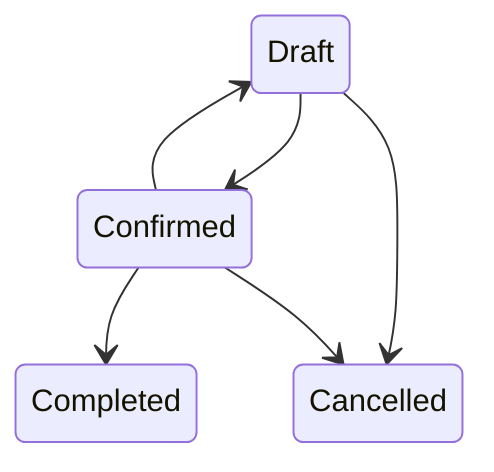

# Orders — What the Customer Bought

For sales representatives and sales managers. An order records what a customer
bought this time: the products or services, how many, and at what price. A
contract, when there is one, records what the two sides agreed; an order can
sit under a contract, and most orders have none.

Find orders under **Orders** in the Sales app, and on the account's page in the
**Orders** list. An order placed under a framework contract also appears on
that contract's page, and counts against the contract's value: an order, or a
higher total on one, that takes the orders under a framework contract over its
value is saved with a warning (see [Contracts](./crm_sales_contracts.md)).

An order's **Contract** is always one of the order's own account. The form
offers only that account's contracts and clears **Contract** when the account
changes; a save that names another account's contract anyway, through the API
for instance, is refused with the message on **Contract**. An order saved that
way before this rule existed is refused on its next edit until its contract
or its account is corrected.

## Recording an order

**New** on the Orders list, or in the account's **Orders** list, opens the
order form. An order needs a name and an account; it starts as **Draft** and
its order date is today unless you change it. The **Customer PO Number** is
the number on the customer's own purchase order, so you can find the order
the way they will quote it.

Add the lines in the order's **Order Lines** list. Choose a product and the line
takes its name and list price, and the sales price starts at the list price
until you type another. A line for something the catalogue does not sell needs
no product: type its **Product Title** and its **Sales Price**.

## Orders from accepted quotes

Where the Quotes and Products module is on, accepting a quote creates its order
by itself: a **Draft** order with the quote's lines and totals, whose **Source
Quote** names the quote. One accepted quote gets one order. **Source Quote** is
filled in by the system and cannot be changed by hand.

Accepting a quote no longer drafts a contract. Until this release it did, for
every accepted quote. An administrator who wants that back switches the flow
**Accepted Quote Drafts a Contract** on: **New in Studio** on the console home page (Studio opens on a *New Package* form; close it with **Cancel**) → **HotCRM Revenue** → **Customize** → **Automations** → **Accepted Quote Drafts a Contract**, then the switch beside *Switched off for this deployment*. The
quote's order then names the drafted contract. The flow **Accepted Quote Creates
an Order** can be switched off where orders are not used. Both choices are kept
across restarts and upgrades.

## Drafting the contract

A subscription or a project usually needs a contract; a product sale usually
does not. **Draft Contract** on the order drafts it: a **Draft** contract typed
*Subscription*, on a 12-month term starting today, at the order's total, named
as the order is, with the order's account, contact, opportunity, owner and
payment terms. Complete
its term, dates and type before you activate it. The order then names the
contract under **Contract**, and you get a **Contract drafted** notice with a
link to it.

The drafted contract is an **order contract** naming this order as its
**Source Order**. Its value is the order's total and is never typed: while the
contract is a draft, a change to the order's amount changes the contract's
value too. Once the contract is activated it keeps the signed value; see
[Contracts](./crm_sales_contracts.md).

**Draft Contract** is offered only while the order names no contract: an order
placed under a framework contract names that one. A **Cancelled** order is not
offered it, and nothing is drafted for one. The order needs a **Contact**,
because a contract names its primary contact; without one nothing is drafted.
A sales rep may run it, though a rep cannot create a contract by hand.

## The totals follow the lines

The order's **Subtotal** is the sum of its lines, recalculated every time a
line is added, changed or removed. The **Discount Amount** and the **Total
Price** are calculated from the subtotal, the order's **Discount %**, the
**Tax** and the **Shipping & Handling**, so they always agree with each other.
On an order with lines the subtotal cannot be typed: a save that changes it to
anything other than the sum of the lines is refused, and you change the lines
instead. An order with no lines keeps the subtotal you type.

## Order status

An order moves through these statuses, and only along these arrows: any other
status change is refused. **Completed** and **Cancelled** are final.

Move an order with the buttons on its page: **Confirm Order** on a Draft
order, **Complete Order** on a Confirmed one, and **Cancel Order** on either.
Only the moves the order can make are offered, and each button asks first.
**Status** on the order's form still changes the status for now, along the
same arrows; Confirmed back to Draft has no button and is made there.

**The lines and the amount of a confirmed order cannot change.** Once an
order leaves **Draft**, adding, changing or removing a line is refused, and the
**New** button leaves its **Order Lines** list. A change to its **Subtotal**,
**Discount %**, **Tax** or **Shipping & Handling** is refused too, so its
**Total Price** stays what was confirmed. To change a confirmed order's lines or
amount, set its **Status** back to **Draft** and save, change them, and click
**Confirm Order** again; the contract and the payment plan then follow the new
total as they do for any change while the order is a draft. A Draft order does
not count towards a framework contract's Order Amount until it is confirmed
again. The lines and the amount of a completed or cancelled order stay as they
are: a difference goes on a new order. The order's other fields, such as the
delivery fields below, can still be edited. Imports and the system's own
updates are not held by this rule.

## Delivery

**Fulfillment Status** (Not Shipped, Partially Shipped, Shipped) and
**Shipped Date** say how far the order has been delivered. Type them, or let
an import fill them; nothing else in HotCRM changes them. The **To Ship** list
shows the confirmed orders that have not fully shipped, oldest first.

**External Reference**, under **System**, is the order's number in another
system, such as the order system it came from. No two orders share one.

---

**Related:** the agreement an order may sit under — see
[Contracts](./crm_sales_contracts.md).
