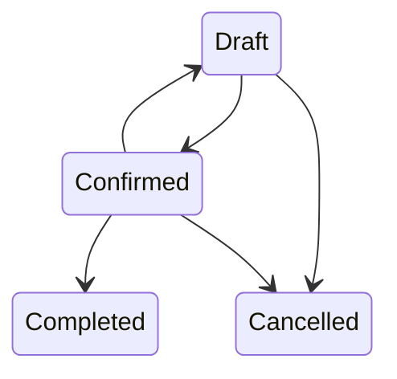

# Orders — What the Customer Bought

For sales representatives and sales managers. An order records what a customer
bought this time: the products or services, how many, and at what price. A
contract, when there is one, records what the two sides agreed; an order can
sit under a contract, and most orders have none.

Find orders under **Orders** in the Sales app, and on the account's page in the
**Orders** list. An order placed under a framework contract also appears on
that contract's page.

## Recording an order

**New** on the Orders list, or in the account's **Orders** list, opens the
order form. An order needs a name and an account; it starts as **Draft** and
its order date is today unless you change it. The **Customer PO Number** is
the number on the customer's own purchase order, so you can find the order
the way they will quote it.

Add the lines in the order's **Order Lines** list. Choose a product and the line
takes its name and list price, and the sales price starts at the list price
until you type another. A line for something the catalogue does not sell needs
no product: type its **Product Title** and its **Sales Price**.

## The totals follow the lines

The order's **Subtotal** is the sum of its lines, recalculated every time a
line is added, changed or removed. The **Discount Amount** and the **Total
Price** are calculated from the subtotal, the order's **Discount %**, the
**Tax** and the **Shipping & Handling**, so they always agree with each other.
An order with no lines keeps the subtotal you type.

## Order status

An order moves through these statuses, and only along these arrows: any other
status change is refused when you save. **Completed** and **Cancelled** are
final.

**The lines of a confirmed order cannot change.** Once an order leaves
**Draft**, adding, changing or removing a line is refused, and the **New**
button leaves its **Order Lines** list. To change a confirmed order's lines,
move it back to **Draft**, change them, and confirm it again. The lines of a
completed or cancelled order stay as they are. The order's other fields, such
as the delivery fields below, can still be edited.

## Delivery

**Fulfillment Status** (Not Shipped, Partially Shipped, Shipped) and
**Shipped Date** say how far the order has been delivered. Type them, or let
an import fill them; nothing else in HotCRM changes them. The **To Ship** list
shows the confirmed orders that have not fully shipped, oldest first.

**External Reference**, under **System**, is the order's number in another
system, such as the order system it came from. No two orders share one.

---

**Related:** the agreement an order may sit under — see
[Contracts](./crm_sales_contracts.md).
