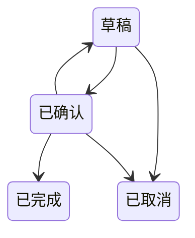

# 订单——客户买了什么

面向销售代表和销售经理。订单记录客户这一次买了什么：哪些产品或服务、多少、什么价格。合同（如果有的话）记录双方约定了什么；订单可以挂在一份合同下，但大多数订单没有合同。

在销售应用的 **订单** 中，以及客户页面的 **订单** 列表中可以找到订单。挂在框架合同下的订单，也会出现在该合同的页面上，并占用合同的金额：一张订单（或调高订单总额）使框架合同下的订单总额超过合同金额时，订单照常保存，并显示一条警告（见[合同](./crm_sales_contracts.md)）。

订单的 **关联合同** 必须属于订单自己的所属客户。表单只列出该客户的合同，更换所属客户时会清空 **关联合同**；如果某次保存仍然指定了另一个客户的合同（例如通过 API），保存会被拒绝，提示显示在 **关联合同** 上。在这条规则生效前这样保存的订单，下次编辑时也会被拒绝，直到改正它的关联合同或所属客户。

## 录入订单

在订单列表或客户的 **订单** 列表中点 **新建**，打开订单表单。订单需要名称和所属客户；新订单的状态是 **草稿**，下单日期默认为今天，可以修改。**客户采购单号** 填写客户自己采购单上的编号，这样可以按客户引用的方式找到这张订单。

在订单的 **订单行** 列表中添加订单行。选择产品后，这一行会带出产品名称和标价，销售单价默认等于标价，可以改成别的价格。目录里没有的东西不需要选产品：填写它的 **产品标题** 和 **销售单价** 即可。

## 来自已接受报价单的订单

在开启了"报价与产品"模块的部署上，接受报价单会自动创建它的订单：一张 **草稿** 订单，带着报价单的明细和合计，它的 **来源报价单** 指向这份报价单。每份被接受的报价单只有一张订单。**来源报价单** 由系统填写，不能手动修改。

接受报价单不再起草合同。在本版本之前，每份被接受的报价单都会起草合同。管理员如需恢复，开启 **已接受的报价单起草合同** 流程：控制台首页的 **在 Studio 中新建**（Studio 会先打开*新建软件包*表单，点 **取消** 关掉）→ **HotCRM Revenue** → **定制** → **自动化** → **Accepted Quote Drafts a Contract**（列表里显示英文名，打开后标题为**已接受的报价单起草合同**），再点 *本部署中已停用* 旁边的开关；此后报价单的订单会指向起草出的合同。不使用订单的部署可以关闭 **已接受的报价单创建订单** 流程。这两项选择在重启和升级后都会保留。

## 起草合同

订阅或项目通常需要合同，产品销售通常不需要。在订单上点 **起草合同** 即可起草：一份 **草稿** 合同，合同类型为 *订阅合同*，期限 12 个月、从今天起算，金额为订单的总金额，名称与订单相同，带着订单的所属客户、联系人、关联商机、负责人和付款条款。激活之前请补全期限、日期和类型。随后订单的 **关联合同** 会指向这份合同，你也会收到一条带链接的 **合同已起草** 通知。

起草出的合同是**订单合同**，它的**来源订单**就是这张订单。合同金额就是订单总额，不手工填写：合同还是草稿时，订单金额一变，合同金额也跟着变。合同激活后保持签署时的金额；见[合同](./crm_sales_contracts.md)。

只有当订单还没有关联合同时才会提供 **起草合同**：挂在框架合同下的订单已经指向那份合同。**已取消** 的订单不提供 **起草合同**，也不会为它起草任何东西。订单需要填写 **联系人**，因为合同必须有主要联系人；没有联系人时不会起草任何东西。销售代表也可以运行它，尽管销售代表不能亲手新建合同。

## 合计随订单行变化

订单的 **小计** 是各订单行之和，每次添加、修改或删除订单行都会重新计算。**折扣金额** 和 **总金额** 由小计、订单的 **折扣 (%)**、**税额** 和 **运费及手续费** 算出，因此三者始终一致。没有订单行的订单保留你填写的小计。

## 订单状态

订单只能沿下图变更状态：其他任何状态变更都会被拒绝。**已完成** 和 **已取消** 是最终状态。

用订单页面上的按钮推进订单：草稿订单点击 **确认订单**，已确认的订单点击 **完成订单**，两者都可以点击 **取消订单**。只会提供订单能做的变更，每个按钮都会先询问。目前仍可以在订单表单上修改 **状态**，同样只能沿下图变更；已确认退回草稿没有按钮，就在表单上完成。

**已确认订单的订单行不能再改。** 订单离开 **草稿** 后，添加、修改或删除订单行都会被拒绝，**订单行** 列表上也不再显示 **新建** 按钮。要修改已确认订单的订单行，请先把 **状态** 改回 **草稿**，改完后再点击 **确认订单**。已完成或已取消订单的订单行保持不变。订单的其他字段（例如下面的发货字段）仍可编辑。

## 发货

**发货状态**（未发货、部分发货、已发货）和 **发货日期** 表示订单发货到了哪一步。可以手动填写，也可以由导入填写；HotCRM 中没有别的功能会改动它们。**待发货** 列表按时间从早到晚列出尚未全部发货的已确认订单。

**系统** 分组中的 **外部编号** 是这张订单在其他系统（例如它来自的订单系统）中的编号。两张订单不能使用同一个外部编号。

---

**相关：** 订单可以挂在其下的约定——参见[合同](./crm_sales_contracts.md)。
