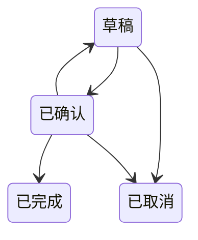

# 订单——客户买了什么

面向销售代表和销售经理。订单记录客户这一次买了什么：哪些产品或服务、多少、什么价格。合同（如果有的话）记录双方约定了什么；订单可以挂在一份合同下，但大多数订单没有合同。

在销售应用的 **订单** 中，以及客户页面的 **订单** 列表中可以找到订单。挂在框架合同下的订单，也会出现在该合同的页面上。

## 录入订单

在订单列表或客户的 **订单** 列表中点 **新建**，打开订单表单。订单需要名称和所属客户；新订单的状态是 **草稿**，下单日期默认为今天，可以修改。**客户采购单号** 填写客户自己采购单上的编号，这样可以按客户引用的方式找到这张订单。

在订单的 **订单行** 列表中添加订单行。选择产品后，这一行会带出产品名称和标价，销售单价默认等于标价，可以改成别的价格。目录里没有的东西不需要选产品：填写它的 **产品标题** 和 **销售单价** 即可。

## 合计随订单行变化

订单的 **小计** 是各订单行之和，每次添加、修改或删除订单行都会重新计算。**折扣金额** 和 **总金额** 由小计、订单的 **折扣 (%)**、**税额** 和 **运费及手续费** 算出，因此三者始终一致。没有订单行的订单保留你填写的小计。

## 订单状态

订单只能沿下图变更状态：其他任何状态变更在保存时都会被拒绝。**已完成** 和 **已取消** 是最终状态。

**已确认订单的订单行不能再改。** 订单离开 **草稿** 后，添加、修改或删除订单行都会被拒绝，**订单行** 列表上也不再显示 **新建** 按钮。要修改已确认订单的订单行，请先把它退回 **草稿**，改完后再确认。已完成或已取消订单的订单行保持不变。订单的其他字段（例如下面的发货字段）仍可编辑。

## 发货

**发货状态**（未发货、部分发货、已发货）和 **发货日期** 表示订单发货到了哪一步。可以手动填写，也可以由导入填写；HotCRM 中没有别的功能会改动它们。**待发货** 列表按时间从早到晚列出尚未全部发货的已确认订单。

**系统** 分组中的 **外部编号** 是这张订单在其他系统（例如它来自的订单系统）中的编号。两张订单不能使用同一个外部编号。

---

**相关：** 订单可以挂在其下的约定——参见[合同](./crm_sales_contracts.md)。
