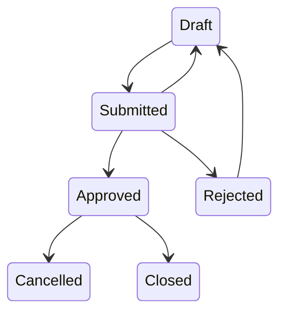

# Travel Requests — Asking Before a Trip

For everyone who travels for the company, and their managers. A travel
request says where you are going, when, why, and roughly how much it will
cost, before any money is spent. Your manager says yes or no, or the
project's Project Manager when the trip is for a project.

A travel request is optional: you can record and submit an expense without
one.

## Filing a request

Open **My Travel Requests** in the **Expenses** app and choose **New**. Four
values are required: the **Purpose**, the **Destination**, the **Start Date**
and **End Date**, and the **Estimated Amount**. **Days** counts both dates.

The **Estimated Amount** is one total for the whole trip, in your
organization's currency, whoever pays for each part. Pick the **Account** if
the trip is for a customer, and the **Project** if it is for a project (with
Project Delivery on; the picker offers no Closed or Cancelled project). Write
the plan in **Itinerary** and anything else in **Notes**; attach files in the
**Files** tab.

**Source** says how the record arrived: typed by a person, written by an
assistant, or imported. **Review Notes** is where an assistant or a rule writes
what it found, for the approver to read. Neither decides anything.

## Itinerary lines

A trip with several legs is easier to book, and to check, leg by leg. On the
request's page, under **Itinerary Lines**, choose **New** for each leg: its
**Kind** (Flight, Train, Car, Hotel or Other), **From** and **To**, the
**Start Date**, the **End Date** (for a hotel, the day you check out) and any
**Details**, such as a seat or a hotel you prefer. The legs are listed in the
order of the trip.

A leg has no amount: the request's **Estimated Amount** is the one total.
Lines are optional; a request with none is complete.

Once the trip is booked, write the confirmation into the leg's **Booking
Reference**. You, an assistant working for you, your approver or whoever books
can write it at any time, also after approval.

## Who approves it

Choose **Submit**. Who decides depends on the **Project**:

- **On a project**: the project's **Project Manager**, the person who answers
  for its cost and approves its expenses, so the trip and its expenses go to
  the same person. A project with no Project Manager, or a trip of the Project
  Manager's own, goes to an administrator.
- **No project**: your **manager**, the manager on your user record; with no
  manager there, the **Finance Controllers**.

Either way, one person decides from their **Inbox**, never both. There is one
step only: finance does not approve a travel request, it checks the money on
the expenses afterwards.

The approver is written into **Approver** when you submit, and the request
appears under their **Requests to Approve**. Nobody approves their own, and
nobody sets **Approved** or **Rejected** by hand.

**A one-person organization.** Nobody approves a request they submitted, an
administrator included, so a request needs a second user who can approve it:
your manager, a Finance Controller or an administrator, or for a request on a
project, the project's Project Manager or an administrator. Until that person
has been added, a submitted request waits in **Submitted** and nobody can
decide it: recall it from your Inbox, and submit it again once they have been
added.

- While it waits, the request is locked. You can **recall** it from your
  Inbox; it goes back to **Draft**.
- **Rejected** sends it back: move it to **Draft**, change the plan and submit
  it again.

## After approval

The approval was given for the plan, so once a request is **Approved** its
**Purpose**, **Destination**, dates, **Estimated Amount** and **Project** no
longer change. The same goes for its legs: from the moment you submit, a leg's
kind, places, dates and details are held, and no leg can be added or removed;
only the **Booking Reference** still takes a value, and not while the request
waits for approval: then every leg is held, its booking reference included,
until the approval is decided. To change the plan, choose **Cancel Trip** and
file a new request.

- **Cancel Trip**: the trip is not happening, or not as planned.
- **Close**: the trip is over.

**Cancelled** and **Closed** are final.

Only a **Draft** request can be deleted. Once it is sent it stays on record,
with its approval and its expense reports: to call off an approved trip,
choose **Cancel Trip**. A rejected request goes back to **Draft** first.

## Reporting the trip's expenses

When you send the trip's expenses for reimbursement, choose **Submit for a
Trip** and pick this request (see *Expenses — Submitting for
reimbursement*). The request then reads its spending against the estimate:

- **Reported Amount**: the totals of its expense reports that are submitted,
  approved or paid. A draft or rejected report is counted once it is sent
  again.
- **Difference from Estimate**: reported minus estimated, so above zero is
  over the estimate. **Over the Estimate** is ticked when it is.
- Its **Expense Reports** are listed on its page.

Each of those reports shows its approver the same figures under **Travel
Request**: the trip's estimate, what has been reported for the trip, and
whether that is over the estimate. Being over is a sign for the approver,
not a block: the report can still be approved.

When finance marks a report paid and no other report of the request is still
draft, submitted or approved, the request becomes **Closed** by itself. A
cancelled or closed request takes no new report, and the picker does not offer
it.

## Who sees what

You see your own requests, and the ones you are asked to approve. Finance sees
every request under **All Travel Requests** and can change none that is not
theirs; so do sales managers and leadership. Project staff also find **My
Travel Requests** in the **Project Delivery** app, and a project's page lists
those of its travel requests the reader may see.
