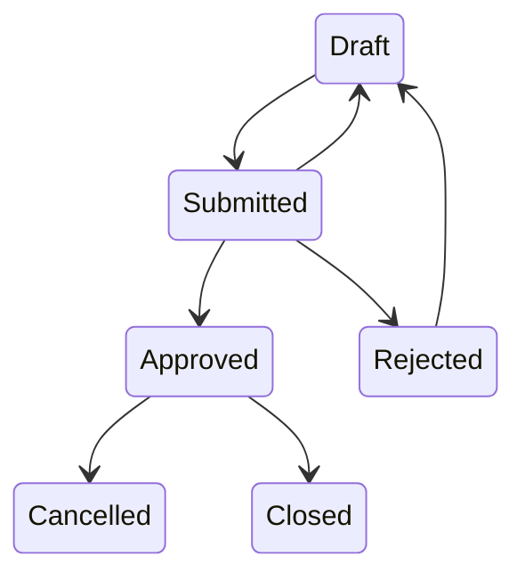

# Travel Requests — Asking Before a Trip

For everyone who travels for the company, and their managers. A travel
request says where you are going, when, why, and roughly how much it will
cost, before any money is spent. Your manager says yes or no.

A travel request is optional: you can record and submit an expense without
one.

## Filing a request

Open **My Travel Requests** in the **Expenses** app and choose **New**. Four
values are required: the **Purpose**, the **Destination**, the **Start Date**
and **End Date**, and the **Estimated Amount**. **Days** counts both dates.

The **Estimated Amount** is one total for the whole trip, in your
organization's currency, whoever pays for each part. Pick the **Account** if
the trip is for a customer. Write the plan in **Itinerary** and anything else
in **Notes**; attach files in the **Files** tab.

**Source** says how the record arrived: typed by a person, written by an
assistant, or imported. **Review Notes** is where an assistant or a rule writes
what it found, for the approver to read. Neither decides anything.

## Itinerary lines

A trip with several legs is easier to book, and to check, leg by leg. On the
request's page, under **Itinerary Lines**, choose **New** for each leg: its
**Kind** (Flight, Train, Car, Hotel or Other), **From** and **To**, the
**Start Date**, the **End Date** (for a hotel, the day you check out) and any
**Details**, such as a seat or a hotel you prefer. The legs are listed in the
order of the trip.

A leg has no amount: the request's **Estimated Amount** is the one total.
Lines are optional; a request with none is complete.

Once the trip is booked, write the confirmation into the leg's **Booking
Reference**. You, an assistant working for you, your approver or whoever books
can write it at any time, also after approval.

## Who approves it

Choose **Submit**. Your **manager**, the manager on your user record, decides
from their **Inbox**; with no manager there, the **Finance Controllers** decide
instead. There is one step only: finance does not approve a travel request,
it checks the money on the expenses afterwards.

The approver is written into **Approver** when you submit, and the request
appears under their **Requests to Approve**. Nobody approves their own, and
nobody sets **Approved** or **Rejected** by hand.

- While it waits, the request is locked. You can **recall** it from your
  Inbox; it goes back to **Draft**.
- **Rejected** sends it back: move it to **Draft**, change the plan and submit
  it again.

## After approval

The approval was given for the plan, so once a request is **Approved** its
**Purpose**, **Destination**, dates and **Estimated Amount** no longer change.
The same goes for its legs: from the
moment you submit, a leg's kind, places, dates and details are held, and no leg
can be added or removed; only the **Booking Reference** still takes a value. To
change the plan, choose **Cancel Trip** and file a new request.

- **Cancel Trip**: the trip is not happening, or not as planned.
- **Close**: the trip is over.

**Cancelled** and **Closed** are final.

## Who sees what

You see your own requests, and the ones you are asked to approve. Finance sees
every request under **All Travel Requests** and can change none that is not
theirs; so do sales managers and leadership.
