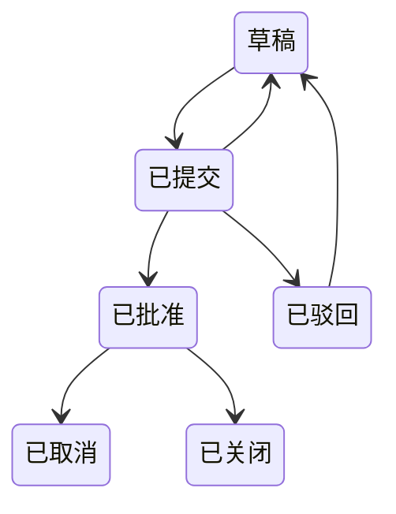

# 出差申请——出差前先申请

写给每个为公司出差的人和他们的上级。出差申请写明去哪里、什么时候、为什么、大约花多少钱，在花钱之前提出，由你的上级批准或驳回；为项目出差时，由项目的项目经理审批。

出差申请不是必需的：没有申请也可以录入和提交费用。

## 填写申请

打开「费用报销」应用中的**我的出差申请**，选择**新建**。必填四项：**出差事由**、**目的地**、**开始日期**和**结束日期**、**预计金额**。**天数**按首尾两天都算。

**预计金额**是整次出差的一个总数，使用贵组织的币种，不论每一部分由谁支付。如果是为客户出差，请选择**客户**；为项目出差，请选择**项目**（启用项目交付时才有；选择框不提供已关闭或已取消的项目）。在**行程**里写计划，其他内容写在**备注**里；附件上传到**文件**页签。

**来源**表示这条记录是怎么来的：手工录入、智能体写入或导入。**检查提示**是智能体或规则写给审批人看的发现。两者都不影响任何判断。

## 行程明细

一次出差有好几程时，按程来订、按程来核对会更清楚。在申请页面的**行程明细**下，每一程选择一次**新建**：**类型**（航班、火车、用车、酒店或其他）、**出发地**和**到达地**、**开始日期**、**结束日期**（酒店填退房日期），以及**要求**，例如座位或想住的酒店。各程按出行顺序列出。

行程明细不带金额：申请上的**预计金额**是唯一的总数。行程明细是可选的，没有明细的申请也是完整的。

订好之后，把确认号写进这一程的**预订号**。你本人、替你办事的智能助手、你的审批人或代订人都可以填写，批准之后也可以；只有申请等待审批期间不行，这时每一程都被锁定，预订号也不例外，直到审批有了结果。

## 由谁审批

选择**提交**。由谁审批取决于**项目**：

- **有项目**：由项目的**项目经理**审批。项目经理对项目成本负责，也审批项目上的费用，所以同一次出差的申请和费用交给同一个人。项目没有项目经理，或者是项目经理自己出差，则交给管理员。
- **没有项目**：由你的**上级**（你用户记录上的上级）审批；没有填写上级时，改由**财务控制**审批。

无论哪种，都只有一个人在**收件箱**中审批，不会两人都审。只有一级审批：财务不审批出差申请，钱的把关在之后的费用上。

提交时，审批人会写入**审批人**字段，申请出现在他们的**待我审批的出差申请**里。不能审批自己的申请，也没有人能手动设置**已批准**或**已驳回**。

**只有一个人的组织。** 没有人能审批自己提交的申请，管理员也一样，所以出差申请需要另一位能审批它的用户：你的上级、一位财务控制或一位管理员；项目上的出差申请则是项目的项目经理或一位管理员。在这个人加入之前，提交的申请停在**已提交**，没有人能决定它：请在收件箱中撤回，等这个人加入后再次提交。

- 等待审批期间，申请被锁定。你可以在收件箱中**撤回**，申请回到**草稿**。
- **已驳回**表示退回：把它改回**草稿**，修改计划后再次提交。

## 批准之后

批准针对的是这份计划，所以申请**已批准**后，**出差事由**、**目的地**、日期、**预计金额**和**项目**都不能再改。行程明细也一样：从提交那一刻起，每一程的类型、地点、日期和要求都被锁定，也不能再添加或删除行程，只有**预订号**还可以填写，但申请等待审批期间不行：这时每一程连同预订号都被锁定，直到审批有了结果。要改计划，请选择**取消出差**，再重新申请。

- **取消出差**：这次出差不去了，或者不按原计划去。
- **关闭**：出差已经结束。

**已取消**和**已关闭**是终点。

只有**草稿**状态的申请可以删除。申请一经提交就保留在记录中，连同它的审批和报销单：要取消已批准的出差，请选择**取消出差**。被驳回的申请要先退回**草稿**。

## 报销这次出差的费用

报销这次出差的费用时，选择**按出差申请报销**，再选这张申请（见《费用》的「提交报销」）。之后申请上会对照预计金额显示花费：

- **已申报金额**：引用本申请、已提交、已批准或已付款的报销单合计。草稿或被驳回的报销单，重新提交后才计入。
- **与预计的差额**：已申报减去预计，大于零就是超出预计；超出时**超出预计**会打勾。
- 申请页面上列出它的**报销单**。

这些报销单在**出差申请**一栏里给审批人看同样的数字：出差的预计金额、这次出差已申报多少、是否超出预计。超出只是提醒审批人，不会拦住：报销单照样可以批准。

财务把一张报销单标记为已付款时，如果这张申请下没有其他报销单还处于草稿、已提交或已批准，申请会自动变为**已关闭**。已取消或已关闭的申请不能再报销，选择时也不会列出。

## 谁能看到

你能看到自己的申请，以及请你审批的申请。财务能在**全部出差申请**里看到所有申请，但不能修改别人的；销售经理和销售领导也一样。项目人员在**项目交付**应用里也能找到**我的出差申请**，项目页面列出这个项目中你能看到的出差申请。
