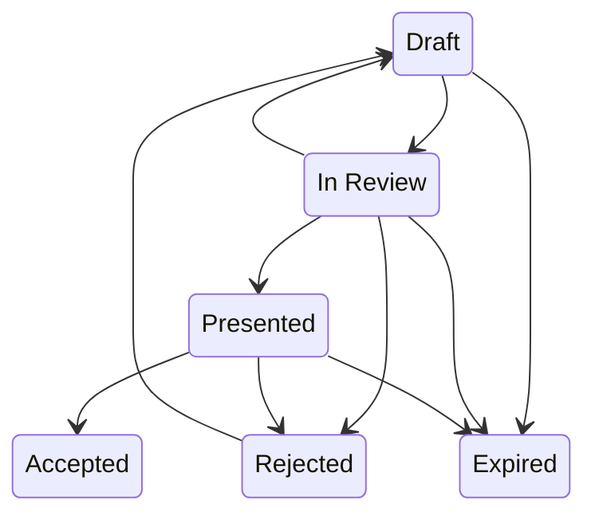

# Quotes — Generation & Expiration

For sales representatives and sales managers. A quote prices a deal for the
customer; this guide covers what the system fills in for you and what it does
on its own.

## Generating a quote

Generate a quote from an opportunity. The quote screen asks for:

- **Quote name**
- **Valid for (days)** — default **30**
- **Discount %** — default **0**

The system computes the math for you: subtotal = the opportunity amount,
discount amount = subtotal × discount %, and **total = amount × (1 − discount%)**.

## Quote status

A quote usually moves along these arrows. A move off them still saves, and the
app only logs a warning. **Accepted** and **Expired** are where a quote ends; a
rejected quote can go back to **Draft** to be reworked.

### Moving a quote along

Each arrow you take by hand has a button on the quote, shown only on the
statuses it leaves from: **Submit for Review** on a Draft, **Mark Presented** on
a quote In Review, **Accept** on a Presented quote, **Reject** on a quote In
Review or Presented, and **Revise** (back to Draft) on a quote In Review or
Rejected. **Accept** asks first, because it cannot be walked back from the
quote: it freezes the quote, closes its opportunity as won and drafts a
contract. The buttons are offered to whoever may edit the quote. The move to
**Expired** has no button; the daily job below makes it.

A new quote starts as **Draft**, **In Review** or **Presented**. The New form
does not offer Accepted, Rejected or Expired, and a save that creates a quote at
one of them is refused.

### Settled quotes

An **Accepted**, **Rejected** or **Expired** quote is settled. It shows no
**Edit**, and its line items show no **New**. Only its **Internal Notes** can
still be changed. A **Rejected** quote is reworked by clicking **Revise**: it goes
back to **Draft**, where its fields and lines can be edited again.

## Quote auto-expiration (automatic)

Where the deployment has switched scheduled work on, a daily **01:00** job marks
any still-open quote past its expiration date as **Expired**. A default install
boots that job unbound, and a lapsed quote keeps its status until someone
changes it. Re-issue a fresh quote if the deal is still live.

---

**Related:** the deal a quote prices — see
[Opportunities](./crm_sales_opportunities.md).
