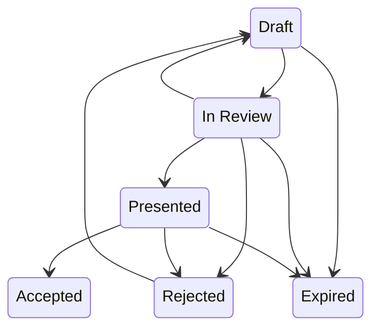

# Quotes — Generation & Expiration

For sales representatives and sales managers. A quote prices a deal for the
customer; this guide covers what the system fills in for you and what it does
on its own.

## Generating a quote

Generate a quote from an opportunity. The quote screen asks for:

- **Quote name**
- **Valid for (days)** — default **30**
- **Discount %** — default **0**

The system computes the math for you: subtotal = the opportunity amount,
discount amount = subtotal × discount %, and **total = amount × (1 − discount%)**.

When you submit, the dialog shows **Quote Created**: the quote is saved as a
**Draft**, and its name is a link that opens it. **Submit** on that screen just
closes the dialog; the quote is already there either way.

## Quote status

A quote usually moves along these arrows. A move off them still saves, and the
save comes back with a warning that spells out the usual path. **Accepted** and **Expired** are where a quote ends; a
rejected quote can go back to **Draft** to be reworked.

## When a quote is accepted

Accepting a quote wins its opportunity and drafts a **contract** from it. A
moment later you get a notice, **Contract drafted**, with the contract number
and a **View** link to it. The contract's term and contract type are starting
values, so check them before you activate it.

## Quote auto-expiration (automatic)

Where the deployment has switched scheduled work on, a daily **01:00** job marks
any still-open quote past its expiration date as **Expired**. A default install
boots that job unbound, and a lapsed quote keeps its status until someone
changes it. Re-issue a fresh quote if the deal is still live.

---

**Related:** the deal a quote prices — see
[Opportunities](./crm_sales_opportunities.md).
