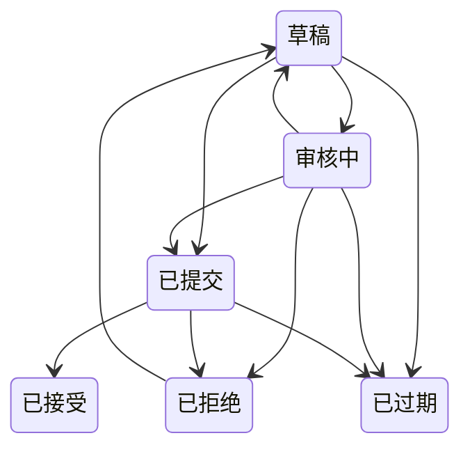

# 报价单——生成与过期

面向销售代表和销售经理。报价单为客户给一笔交易定价；本指南讲的是系统替你填写什么，以及它会自己做什么。

## 生成报价单

在商机上点击**生成报价单**。**报价单详情**界面会询问：

- **报价名称**
- **有效期（天）**——默认 **30**
- **折扣 %**——默认 **0**

计算由系统完成：小计 = 商机金额，折扣金额 = 小计 × 折扣 %，**总金额 = 金额 × (1 − 折扣%)**。

提交后，对话框会显示**报价单已创建**：报价单已保存为**草稿**，名称就是打开它的链接。这个界面上的**提交**只是关闭对话框；无论是否点击，报价单都已经创建好了。

## 报价单状态

报价单通常沿下图流转。偏离箭头的变更照样会保存，保存结果会附带一条警告，写明通常的流转路径。**已接受**和**已过期**是报价单的终点；被拒绝的报价单可以退回**草稿**重新修改。

### 推进报价单

每条需要手动走的箭头在报价单上都有一个按钮，只在它出发的状态上显示：草稿上的**提交审核**，审核中的**标记为已提交**，已提交的**接受**，审核中或已提交的**拒绝**，以及审核中或已拒绝的**修订**（退回草稿）。**接受**需要报价单的签署副本（见下文），并会先确认，因为在报价单上无法撤回：它会冻结报价单、把商机关闭为赢单并起草一份合同。这些按钮只对可以编辑该报价单的人显示。转为**已过期**没有按钮，由下面的每日任务完成。从**草稿**直接转为**已提交**，靠打印报价单完成（见下文）。

新建的报价单只能从**草稿**、**审核中**或**已提交**开始。新建表单不提供已接受、已拒绝和已过期，以这三种状态创建报价单的保存会被拒绝。

### 已结束的报价单

**已接受**、**已拒绝**或**已过期**的报价单已经结束。它不显示**编辑**，它的报价明细也不显示**新建**，只有**内部备注**还能修改。**已拒绝**的报价单要重新修改，请点击**修订**：它会退回**草稿**，在草稿上字段和明细都可以再次编辑。

## 打印报价单

报价单上以及报价单列表行菜单里的**打印报价**，会把报价单打印成一份文档，并以你的名义把 PDF 归档到报价单的**附件**中。这个按钮只对可以编辑该报价单、并且可以添加附件的人显示。

打印即提交：PDF 归档后，**草稿**或**审核中**的报价单会转为**已提交**。其他状态的报价单保持原状态，所以可以随时重新打印；你自己上传的附件不会改变状态。这次状态变更是以你的名义进行的普通保存，所以没有填写**联系人**的报价单照样会打印并归档，但状态不变，而且不会有任何提示。打印后请查看状态；补上联系人后再打印一次即可。

## 归档签署副本

客户签好报价后，在报价单处于**已提交**时，把客户寄回的文件上传到报价单的**签署副本**。**报价单必须有签署副本才能接受：** 在上传文件之前，**接受**按钮和任何把报价单改为**已接受**的保存都会被拒绝，并指明**签署副本**。在这条规则之前就已接受的报价单保持原样。

## 报价单被接受时

接受报价单会让对应商机赢单，并据此起草一份**合同**。稍后你会收到一条**合同已起草**的通知，写明合同编号，并带有打开合同的**查看**链接。合同的期限和合同类型只是初始值，激活前请先核对。

## 报价单自动过期（自动）

在开启了计划任务的部署上，每天 **01:00** 的任务会把已过到期日期、仍未结束的报价单标记为**已过期**。默认安装启动时这个任务未绑定，过期的报价单会保持原状态，直到有人修改它。如果交易仍在进行，请重新出一份报价单。

---

**相关：** 报价单所定价的那笔商机——见[商机](./crm_sales_opportunities.md)。
