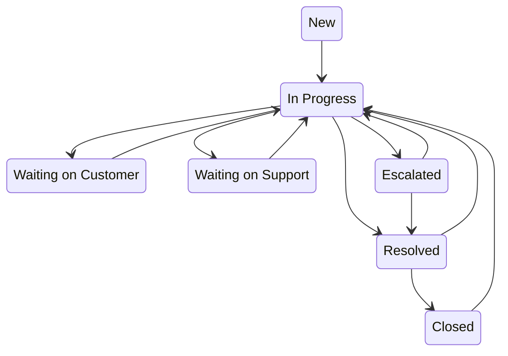

# Cases — Priority, SLA & Escalation

For service agents and service managers. Cases move from intake to resolution,
and the system enforces SLAs and escalations automatically — this guide explains
exactly when and how.

## Case status

A case usually moves along these arrows. Every open status can also go straight
to **Escalated** or **Closed**, and a closed case can be reopened. A move off
the usual path still saves, and the app only logs a warning.

### Reopening a case

A **Resolved** or **Closed** case shows a **Reopen Case** button to anyone who
may edit cases. It puts the case back to **In Progress**, and the case counts as
open again.

What reopening does to the SLA:

- The **SLA Due Date** is kept. The clock is not restarted, so a case reopened
  after its due date is overdue the moment it is reopened.
- A breach already recorded stays recorded: **SLA Violated** is not cleared.
- Resolving or closing it again after the due date marks it **SLA Violated**
  on that save, as for any case.

## Case priority and the SLA due date

Every case carries a **priority**, from **Low** to **Critical**, that drives its
urgency.

Each case also carries an **SLA Due Date** — the deadline to resolve it. It is
set automatically when the case is logged, from a **priority × account-tier
matrix**: the case's priority is looked up against the **Customer Tier** of its
account, and the resulting number of hours is added to the time of creation.
Critical is four hours on every tier; the other three priorities tighten as the
tier rises (an account with no tier set is treated as SMB).

> Those are **calendar** hours, not business hours. This app has no
> working-day calendar and no holiday list, so nights, weekends and holidays
> count against every target — a Critical case raised at 5pm on a Friday is due
> at 9pm that same Friday.

The automation below watches that clock and the priority for you.

## The clock is watched for you — SLA breach handling (automatic)

On a deployment that has switched scheduled work on, an **hourly** sweep checks
every open case. If a case passes its **SLA Due Date** without being resolved,
the system automatically:

- marks it **SLA Violated**,
- **escalates** it (status → *Escalated*, with an escalation reason stamped), and
- alerts the owner.

Where the sweep runs, you never have to manually catch a missed SLA — but you
should work cases before the due date, because a breach is recorded permanently
on the case. A default install boots the sweep unbound (scheduled work is off
until your administrator turns it on), so there no open case is flagged or
escalated and nobody is alerted: watch the **SLA Due Date** yourself.

On every install, sweep or no sweep, a case that is resolved or closed after
its **SLA Due Date** is marked **SLA Violated** on that save — it is not
escalated and nobody is alerted, because the work is already done, but the SLA
report and the compliance gauge count it.

A case marked **SLA Violated** shows a red **SLA breached** banner under its
header. A case on track shows none; the header strip keeps the **SLA Due Date**.

## Critical cases escalate instantly (automatic)

The moment a case is set to **Critical** priority, it escalates without waiting
for the SLA clock:

- status moves to **Escalated** with an escalation reason stamped, and the case
  is handed to the **Service Manager** carrying the fewest open cases — with
  nobody holding that position it stays with its current owner,
- an **urgent follow-up task** is created for the account owner (due the next
  day), and
- the case owner is notified.

> Two safety nets, two triggers: **priority = Critical** escalates *immediately*;
> a **missed SLA Due Date** escalates *on breach*. Both flag, hand the case to
> the Service Manager pool, and alert the agent it came from — and both leave it
> where it is when that pool is unstaffed.

## Cases from the public support form

Visitors who are not signed in raise cases on the public support form
(**Contact Support**, at `/forms/support`). It asks for their name and email
(**Your name** and **Your email**, stored on the case as **Supplied Name** and
**Supplied Email**), a subject, a description and a case type, and above the
fields it reads: *For an urgent outage, call the service hotline.*

The form does not ask for a priority. A web case arrives at **Low**, with
**Case Origin** set to **Web**, and you triage it from there. A visitor can never
open a **Critical** case: the app holds a visitor's case at **High** at most, so
a web case never escalates on arrival and never goes to the Service Manager pool
by itself. Critical is a staff decision. When a visitor's problem really is
urgent, raise the priority yourself and the escalation above runs.

---

**Related:** recording which article solved a case — see
[Knowledge](./crm_service_knowledge.md).
