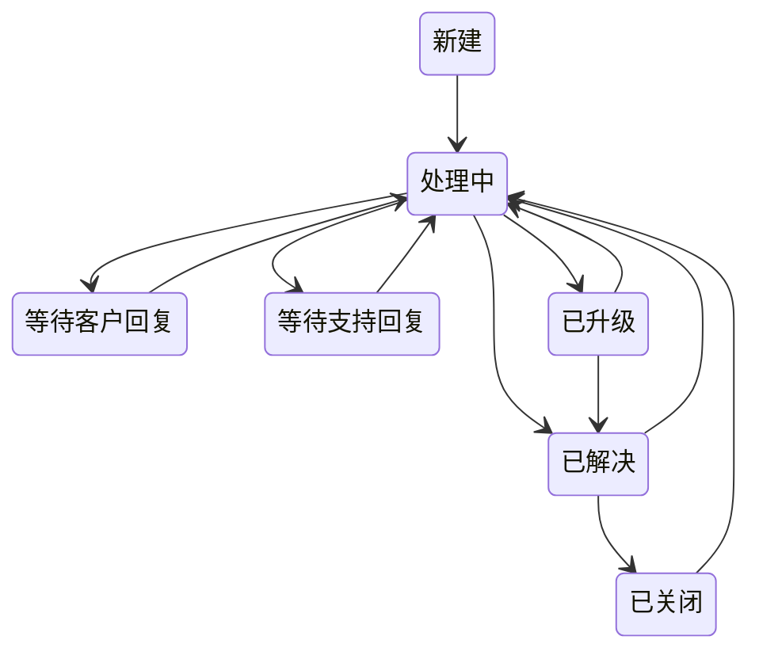

# 工单——优先级、SLA 与升级

面向客服专员和服务经理。工单从受理走到解决，系统会自动执行 SLA 和升级——本指南准确说明何时、如何执行。

## 工单状态

工单通常沿下图流转。每个未结状态还可以直接变为**已升级**或**已关闭**，已关闭的工单也可以重新打开。偏离常规路径的变更照样会保存，应用只记一条警告。

### 重新打开工单

**已解决**或**已关闭**的工单会向可以编辑工单的人显示**重新打开工单**按钮。它把工单退回**处理中**，工单重新算作未结。

重新打开对 SLA 的影响：

- **SLA 到期**时间保持不变。时钟不会重新计时，所以过了到期时间才重新打开的工单，一打开就是逾期的。
- 已经记录的违约仍然保留：**SLA 违反**不会被清除。
- 过了到期时间后再次解决或关闭，与任何工单一样，那次保存会把它标记为 **SLA 违反**。

## 工单优先级和 SLA 到期时间

每张工单都有一个**优先级**，从**低**到**严重**，决定它的紧急程度。

每张工单还带有一个 **SLA 到期**时间——解决它的最后期限。它在工单登记时自动设定，来自一张**优先级 × 客户分层矩阵**：用工单的优先级去查其所属客户的**客户分层**，把查到的小时数加到创建时间上。严重工单在每个分层上都是四小时；其余三个优先级随分层升高而收紧（没有设置分层的客户按中小客户处理）。

> 这些是**日历**小时，不是工作小时。本应用没有工作日历，也没有节假日列表，所以夜间、周末和节假日都计入每一个目标——周五下午 5 点提交的严重工单，当天晚上 9 点就到期。

下面的自动化替你盯着这个时钟和优先级。

## 时钟由系统替你盯着——SLA 违约处理（自动）

在开启了计划任务的部署上，**每小时**一次的扫描会检查每一张未结工单。如果工单过了 **SLA 到期**时间仍未解决，系统会自动：

- 把它标记为 **SLA 违反**，
- **升级**它（状态 → *已升级*，并记录升级原因），以及
- 提醒负责人。

在运行扫描的环境里，你永远不必手工去抓错过的 SLA——但你应当在到期前处理工单，因为违约会永久记录在工单上。默认安装启动时扫描未绑定（计划任务默认关闭，需要你的管理员开启），所以那里不会有工单被标记或升级，也不会有人收到提醒：请自己留意 **SLA 到期**时间。

在任何安装上，无论有没有扫描，在 **SLA 到期**之后才被解决或关闭的工单，都会在那次保存时被标记为 **SLA 违反**——它不会被升级，也不会提醒任何人，因为工作已经完成，但 SLA 报表和合规仪表都会把它计入。

## 严重工单立即升级（自动）

工单一旦被设为**严重**优先级，就会立即升级，不等 SLA 时钟：

- 状态变为**已升级**并记录升级原因，工单交给名下未结工单最少的**服务经理**——该岗位无人时，工单留在当前负责人手里，
- 为客户负责人创建一条**紧急跟进任务**（第二天到期），以及
- 通知工单负责人。

> 两张安全网，两个触发条件：**优先级 = 严重**会*立即*升级；**错过 SLA 到期**会*在违约时*升级。两者都会标记工单、把它交给服务经理池、并提醒原来的客服——服务经理池无人时，两者都让工单留在原处。

## 来自公开支持表单的工单

未登录的访客在公开支持表单（**联系支持团队**，地址 `/forms/support`）上提交工单。表单询问他们的姓名和邮箱（**您的姓名**、**您的邮箱**，在工单上保存为**提交人姓名**和**提交人邮箱**）、主题、描述和类型，字段上方写着：*紧急故障请拨打服务热线。*

表单不询问优先级。网页工单以**低**优先级到达，**工单来源**为**网站**，由你从这里开始分诊。访客永远无法开出**严重**工单：应用对访客工单的优先级最高只到**高**，所以网页工单到达时不会升级，也不会自行进入服务经理池。设为严重是员工的决定。访客的问题确实紧急时，由你提高优先级，上面的升级随即发生。

---

**相关：** 记录是哪篇文章解决了工单——见[知识库](./crm_service_knowledge.md)。
